# GRN-Sim & phpIoRN 2.0: Gene Regulatory Network Perturbation Simulator & Reverse Engineering Suite

[](https://www.python.org/)
[](Dockerfile)
[](LICENSE)
[]()

A full-stack Python framework and interactive web simulation studio (**phpIoRN 2.0**) for non-linear gene regulatory network (GRN) perturbation simulation, oscillation/steady-state detection, and network topology reverse engineering.

This package is a faithful, modern reverse-engineering and expansion of the foundational MATLAB + `phpIoRN` research software developed by **Jan Wildenhain** and **Edmund J. Crampin**, stemming from the Bachelor of Honours Thesis:
> **"In Silico Modelling of Gene Networks and Reverse Engineering of Transcriptional Networks"**  
> *Jan Wildenhain (2004/2005)*

---

## 📖 Citation & Academic Reference

If you use this software or its methodology in your research, please cite the primary publication:

```bibtex
@article{WildenhainCrampin2006,
  author    = {Wildenhain, Jan and Crampin, Edmund J.},
  title     = {Reconstructing gene regulatory networks: from random to scale-free connectivity},
  journal   = {IEE Proceedings - Systems Biology},
  volume    = {153},
  number    = {4},
  pages     = {247--256},
  year      = {2006},
  publisher = {IET},
  doi       = {10.1049/ip-syb:20050073},
  url       = {https://doi.org/10.1049/ip-syb:20050073}
}
```

> **Wildenhain, J., & Crampin, E. J. (2006).** *Reconstructing gene regulatory networks: from random to scale-free connectivity.* **IEE Proceedings - Systems Biology**, 153(4), 247–256. [doi:10.1049/ip-syb:20050073](https://doi.org/10.1049/ip-syb:20050073).

---

## 📸 Visual Tour (`phpIoRN 2.0` Web Application)

### 1. Simulation & Inference Wizard Studio (Dark & Light Themes)
Full 3-step `phpIoRN` simulation workflow (`get_network.php` → `run_sim.php` → `show_sim.php`) featuring force-directed / circular / hierarchical graph layouts, steady-state vs. oscillation diagnostics, $3 \times 3 + \text{marginals}$ Observed vs. Predicted misclassification matrices (`$TMP_CMAT`), 8-metric performance bars (`$TMP_STATMAT`), and `.msmt` / `.pert` / `.dot` / `.json` exports:

| Dark Theme (`Simulation Studio`) | Light Theme (`Simulation Studio`) |
| :---: | :---: |
|  |  |

### 2. Native Graphviz `dot`/`neato` 9-State Classification SVG & Interactive ODE/Hill Popups
Exact reproduction of `statsgraph_to_dot.m` 9-state edge styling (`TP+`, `TP-`, `FP+`, `FP-`, `FN+`, `FN-`, `SignErr +-`, `SignErr -+`) and interactive `popups.php` modals when clicking any gene node or regulatory edge:

| Graphviz 9-State SVG (`statsgraph_to_dot.m`) | Node ODE Trajectory Inspector (`popups.php?type=node`) | Edge Hill Kinetics Curve (`popups.php?type=edge`) |
| :---: | :---: | :---: |
|  |  |  |

### 3. *E. coli* SOS DNA Repair Benchmark, Thesis Figures Gallery & Persistent SQLite Archive
Replication of the 9-gene *E. coli* SOS DNA Repair Pathway (Gardner et al., *Science* 2003; Thesis Table 4.1), Thesis & Paper Figures Gallery, and persistent SQLite database archive (`nw` + `alg` tables from `dumpdb.sql`) with interactive run inspection (`showpre.php`):

| *E. coli* SOS Pathway (Table 4.1) | Thesis & Paper Figures Gallery | SQLite Simulation Archive (`showpre.php`) |
| :---: | :---: | :---: |
|  |  |  |

### 4. Virtual Cell Challenge 2026 & AtlasShift Studio (Tabs 1 & 4)
Direct comparative benchmarking between Mechanistic Causal GRN modeling (`phpIoRN`) and Cross-Atlas Empirical Transfer (`AtlasShift`, Kaipeng Meng, Arc Institute VCC 2026 Leaderboard #82). Features seen vs. genuinely held-out perturbation analysis (the response models are refit without the held-out experiments), cell line edge rewiring sensitivity curves ($\rho \in [0\%, 50\%]$), a true double-perturbation epistasis screen, a virtual single-cell sequencer (2D PCA), and single-cell `.h5ad` AnnData export (400 cells/condition):

| Tab 1: Studio with AtlasShift | Tab 4: VCC Benchmark (Dark Theme) | Tab 4: VCC Benchmark (Light Theme) |
| :---: | :---: | :---: |
|  |  |  |

### 5. Multi-Paradigm Simulation Engines & Real-World Benchmarks Studio (Tabs 1 & 2)
Complete integration of 4 simulation dynamics engines (`hill_nonlinear`, `cellbox_neural_ode`, `linear_jacobian`, `perturb_seq_counts`), 18 reverse-engineering inference algorithms (`S2G`, `G2S`, `Voting`, `CellBox`, `GENIE3`, `NetDeconv`, `RidgeCV`, `CPALite`, `AtlasShift`, `NIR`, `FAST`, `By-Chance`, `ARACNE`, `CausalGRN`, `DMD-GRN`, `DeepRIG`, `SFINN`, `NOTEARS`), and real-world benchmark datasets (`ecoli_sos`, `dream4_10gene`, `norman_2019_tf16`, `replogle_2022_p53`):

| Tab 1: Multi-Paradigm Studio (Dark) | Tab 1: Multi-Paradigm Studio (Light) | Tab 2: Real-World Benchmarks Studio |
| :---: | :---: | :---: |
|  |  |  |

| Tab 2: Norman 2019 16-TF Perturb-seq Benchmark | Tab 1: Loaded Real-World Norman Circuit in Studio |
| :---: | :---: |
|  |  |

### 6. Comprehensive Application Audit & Verified Real Biological Dynamics (Tabs 1–5)
Rigorous end-to-end verification across real biological datasets (*E. coli* SOS, Norman 2019 CRISPRa 16-TF screen, DREAM4, Replogle 2022 p53), interactive clickable node dynamics, universal table sorting, and persistent SQLite dynamics archive:

| Tab 1: Studio Verified (6-Step Pipeline) | Tab 2: Real Benchmarks Studio | Tab 3: Previous Simulations Archive |
| :---: | :---: | :---: |
|  |  |  |

| Tab 4: Virtual Cell Challenge Studio | Tab 5: Overall Statistics & Historical Gallery | Reordered Top Navigation Header |
| :---: | :---: | :---: |
|  | 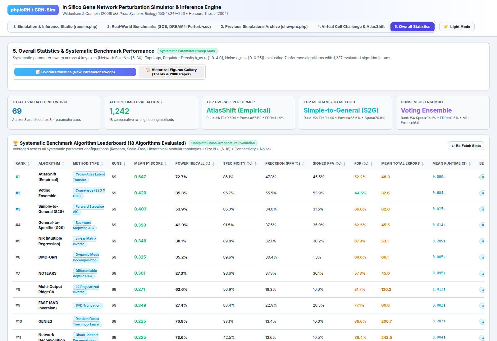 | 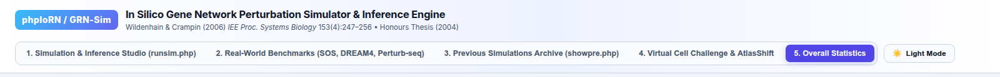 |

| Interactive Node Click Dynamics (*E. coli* SOS) | Single-Cell CRISPRa Trajectory (Norman 2019) |
| :---: | :---: |
|  |  |

### 7. Real-World Benchmarks Studio: Provenance Cards, Raw Downloads & Dual Loading Modes (Tab 2)
Tab 2 integrates comprehensive real-world experimental benchmarks (*E. coli* SOS, Norman et al. 2019 CRISPRa 16-TF, DREAM4, Replogle et al. 2022 p53), multi-format raw dataset downloads, detailed experimental provenance cards, and dual-mode transfer into Tab 1 with strict UX distinctions:

| Tab 2: Raw Data Download Menu | Tab 2: Norman 2019 Provenance Card | Tab 2: Replogle p53 Provenance Card |
| :---: | :---: | :---: |
|  |  |  |

| Tab 1: Locked Simulation Wizard (Greyed Out) | Tab 1: Step 3 Validated Circuit Label |
| :---: | :---: |
|  |  |

| Tab 1: Step 4 Empirical Response Profile (No ODE) | Tab 1: Restored Synthetic Simulation Mode |
| :---: | :---: |
|  |  |

| Tab 1: Biophysical Parameter Estimation Labels | Tab 1: Step 4 Toggle Line Plot vs Bar Plot |
| :---: | :---: |
|  |  |

### 8. Historical Simulations Archive: Step 4 Perturbation Dynamics, Expression Matrix & Trajectory Review (Tab 4)
The Historical Archive (Tab 4) incorporates a full **Step 4: Perturbation ODE Time-Course & Expression Matrix** inspection panel with interactive multi-mode toggles, condition switching, and dynamical trajectory analysis:

| Tab 4: Step 4 Perturbation Time-Course (Responsive) | Tab 4: Step 4 Expression Matrix Heatmap ($X$) |
| :---: | :---: |
| 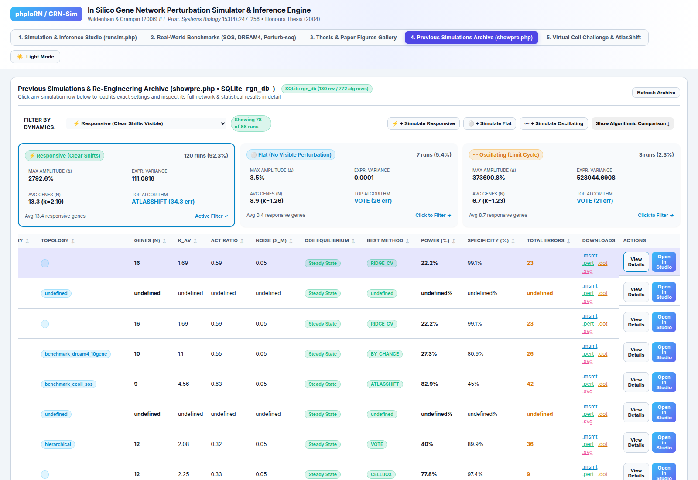 | 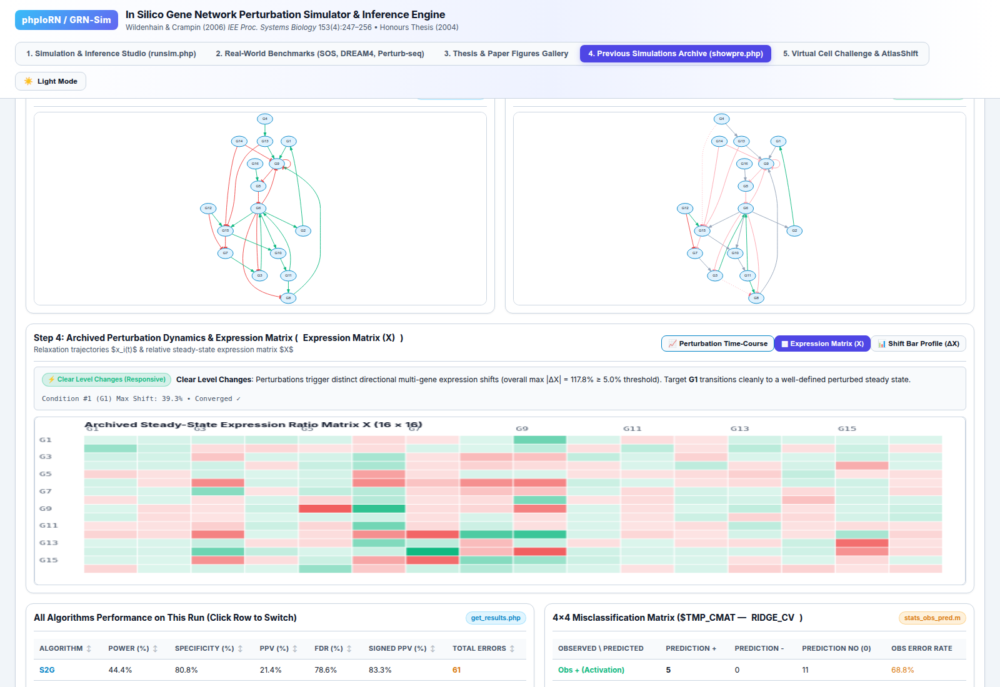 |

| Tab 4: Step 4 Flat Dynamics (Insensitive Trajectory) | Tab 4: Step 4 Limit Cycle Oscillations |
| :---: | :---: |
| 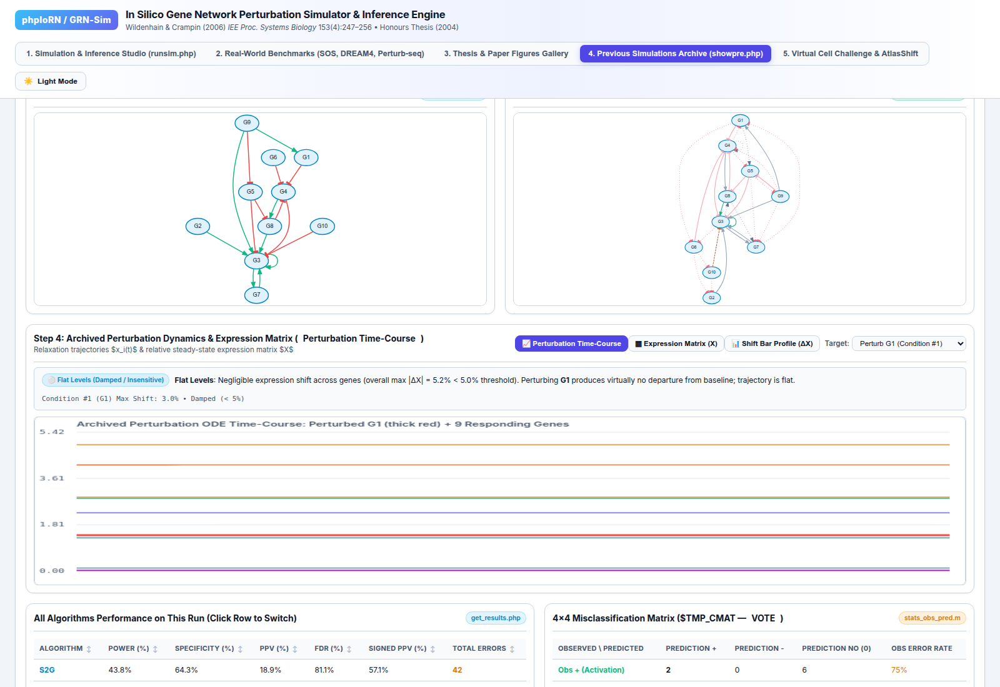 | 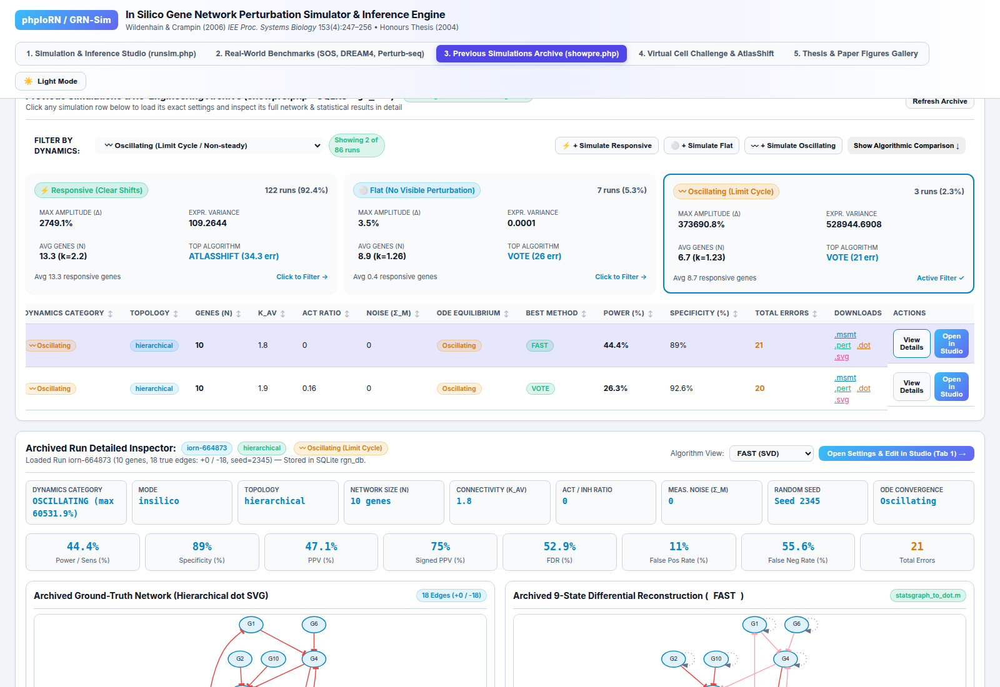 |

### 9. Representative Dynamical Regimes: Responsive vs Flat vs Oscillating
Following a rigorous audit of the ODE simulation engine and a 100-parameter dynamical sweep, three distinct representative regimes were generated, verified, and catalogued:

| Representative 1: Responsive (`iorn-rep-responsive`) | Representative 2: Flat (`iorn-rep-flat`) | Representative 3: Oscillating (`iorn-rep-oscillating`) |
| :---: | :---: | :---: |
| 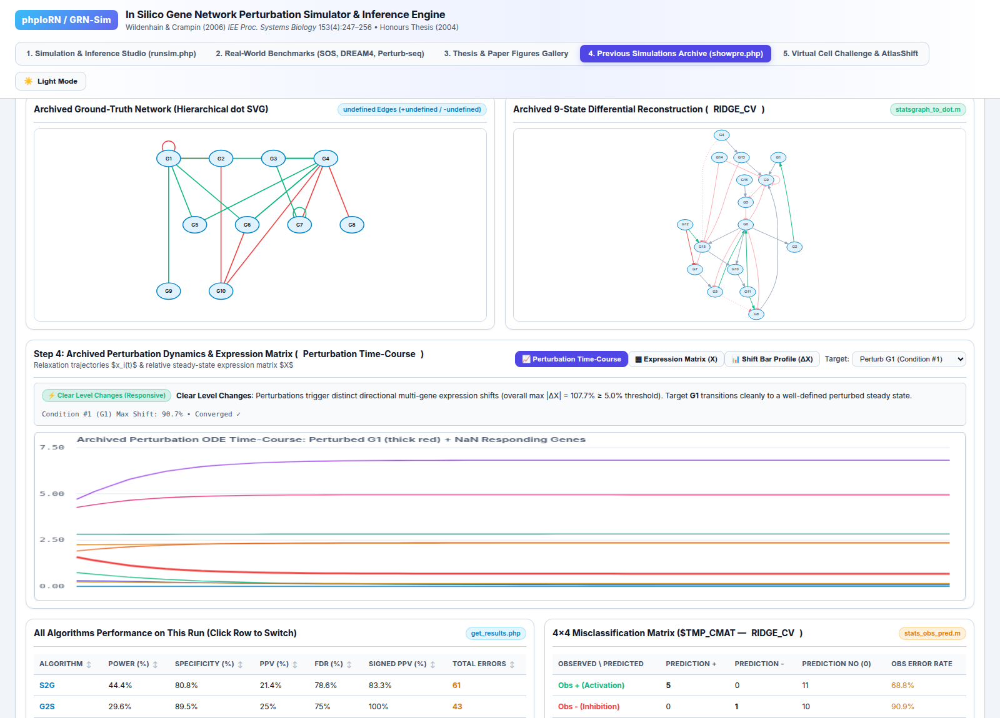 | 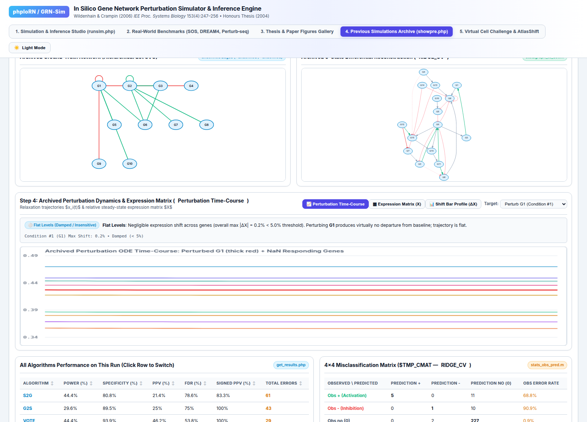 | 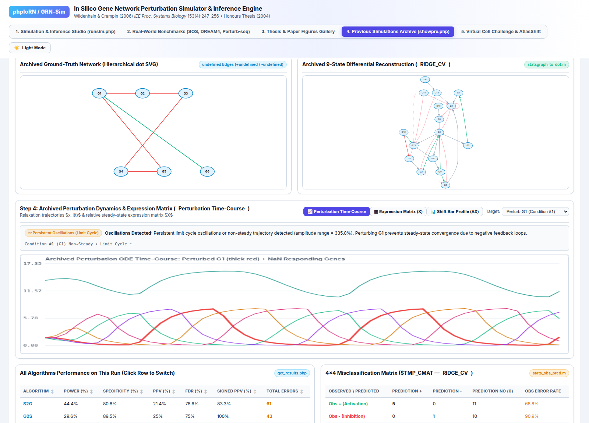 |
| **⚡ Clear Level Changes**: Target gene transitions smoothly to new stable steady state ($\max \|\Delta X\| = 107.7\% \ge 5\%$). Tail fluctuation $< 0.0001$. | **⚪ Flat / Insensitive**: Perturbations produce negligible response ($\max \|\Delta X\| = 0.2\% < 5\%$). Trajectory settles horizontally. | **〰 Persistent Oscillations**: Limit cycle dynamics where the simulation **does NOT reach steady state** after perturbation (amplitude $= 335.8\%$). |

### 10. Side-by-Side Dual Graphs & 3×3 Multi-Perturbation Shift Bar Grid (Tab 3)
In Tab 3 (Previous Simulations Archive), Step 4 is split into **two side-by-side graphs** showing continuous ODE time-course relaxation trajectories alongside the full steady-state expression ratio matrix heatmap ($X$). Toggling to the **Shift Bar Profile** renders several perturbation responses simultaneously in an interactive **3×3 multi-perturbation grid** with soft transparent pastel background zoning:
- **▲ Up-regulation Zone ($y > 0$, $+\Delta X$)**: Soft transparent pastel green background (`rgba(16, 185, 129, 0.08)` in light, `0.12` in dark) indicating genes whose steady-state expression increases above baseline.
- **▼ Down-regulation Zone ($y < 0$, $-\Delta X$)**: Soft transparent pastel red background (`rgba(239, 68, 68, 0.08)` in light, `0.12` in dark) indicating genes whose steady-state expression decreases below baseline.
- **Subplot Card Framing & Condition Badges**: Adapts border and badge tints dynamically to the perturbation type: pastel green for induction/over-expression ($\Delta X \ge 0$), pastel red for inhibition/knockdown ($\Delta X < 0$).
- **Integrated Color Legend**: Built-in toolbar badges define Up-regulation (Pastel Green), Down-regulation (Pastel Red), and Target Gene (Cyan/Blue).

| Tab 3: 3×3 Pastel Grid (Dark Mode) | Tab 3: 3×3 Pastel Grid (Light Mode) |
| :---: | :---: |
| 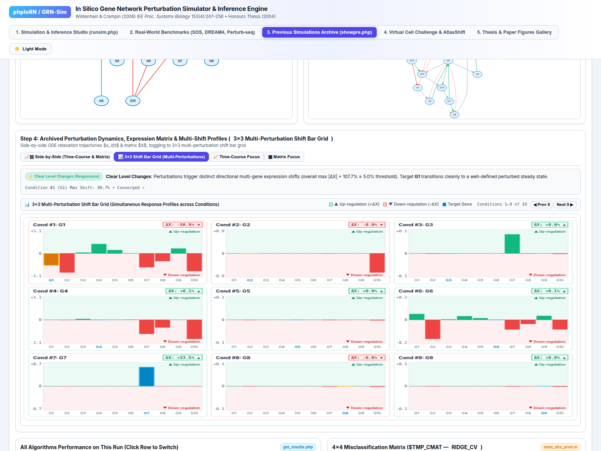 | 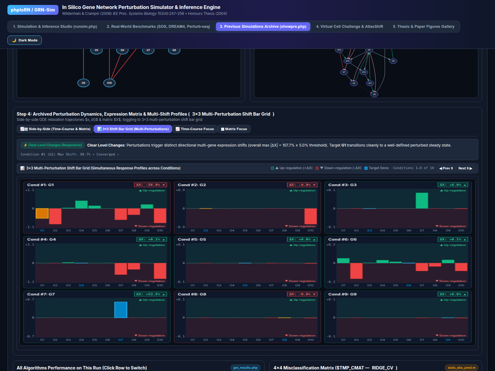 |

| Tab 3: 3×3 Pastel Grid Detail (Dark) | Tab 3: 3×3 Pastel Grid Detail (Light) |
| :---: | :---: |
| 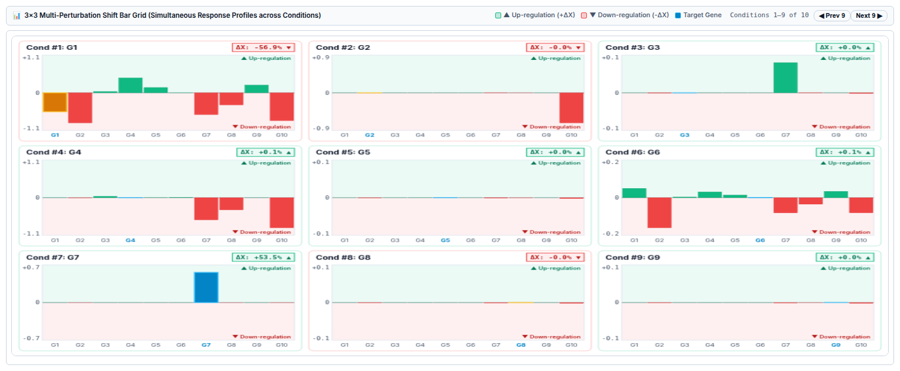 | 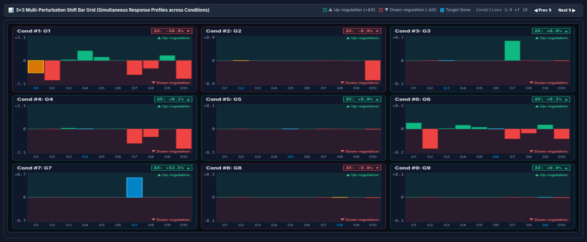 |

| Tab 3: Side-by-Side Dual Graph (Time-Course & Matrix) | Tab 3: Side-by-Side Dual View (Limit Cycle Oscillations) |
| :---: | :---: |
| 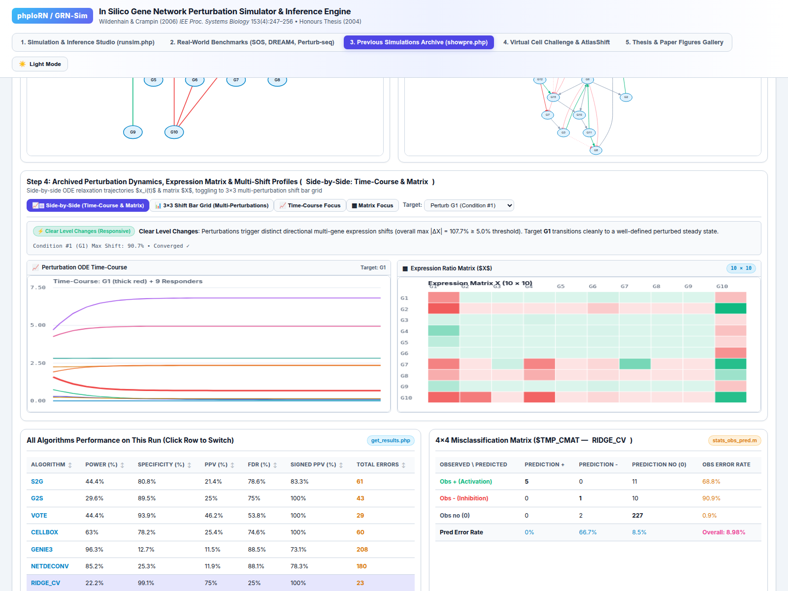 | 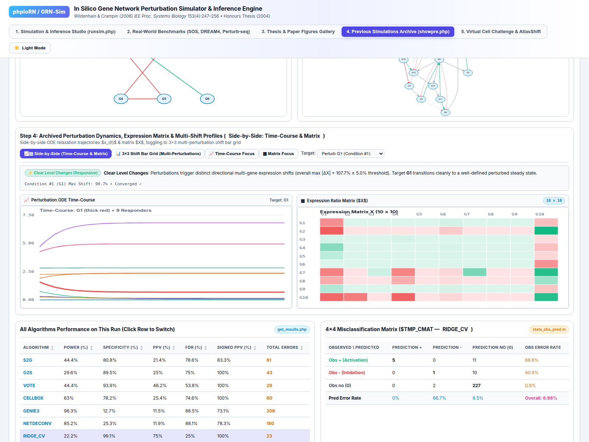 |

### 11. Complete 18-Algorithm Benchmark, Overall Statistics & Cross-Architecture Evaluation (Tabs 3 & 5)

> 📊 **Full Technical & Benchmark Specification**: See [`docs/BENCHMARK_18_ALGORITHMS_AND_ARCHITECTURES.md`](docs/BENCHMARK_18_ALGORITHMS_AND_ARCHITECTURES.md) for complete mathematical formulations, per-architecture leaderboards, and parameter sweeps across Random, Scale-Free, and Hierarchical Modular topologies.

A comprehensive systematic parameter sweep benchmark extended to match **Jan Wildenhain's 2004 BHons Thesis & 2006 IEE Systems Biology paper** experimental ranges across 4 continuous and structural axes:
- **Network Size**: $N \in [12, 20, 30, 40, 50, 60]$ genes (preserving $N \ge 12$).
- **Topologies (3)**: Random Erdős-Rényi, Scale-Free / Power-Law (Barabási-Albert), and Hierarchical Modular (Ravasz-Barabási).
- **Average Connectivity**: $k_{\text{av}} \in [1.0, 1.5, 2.0, 2.5, 3.0, 4.0, 5.0]$ edges/gene (matching thesis $k \in \{1, 1.5, 2, 3, 5\}$).
- **Measurement Noise Sensitivity**: $\sigma_m \in [0.00, 0.02, 0.05, 0.10, 0.15, 0.20, 0.25]$ Gaussian noise on steady-state ratios.
- **Computational Runtime Scaling**: Empirically measured algorithm execution time (seconds) scaling across network dimensions ($N \in [12, 60]$), matching Thesis Figure 4.10.
- **Total Systematic Evaluated Runs**: 69 systematic network runs $\times 18$ algorithms = **1,242 algorithmic evaluations**.

1. **Tab 5 Renamed to "5. Overall Statistics"**:
   - **Complete 18-Algorithm Leaderboard**: Real-time multi-metric cross-evaluation of all 18 inference methods in the repository (`AtlasShift`, `Simple-to-General (S2G)`, `Voting Ensemble`, `General-to-Specific (G2S)`, `NIR`, `Multi-Output RidgeCV`, `CellBox Neural ODE`, `Network Deconvolution`, `FAST SVD Inversion`, `GENIE3`, `CPA-Lite Autoencoder`, `DeepRIG`, `CausalGRN`, `By-Chance Null Model`, `DMD-GRN`, `ARACNE`, `SFINN`, `NOTEARS`).
   - **Leaderboard Performance Summary**:
     - **#1 AtlasShift (Empirical Latent Transfer)**: Top overall re-engineering accuracy with Mean $F_1 = 0.547$, Power / Recall $= 72.7\%$, Specificity $= 86.1\%$, FDR $= 52.2\%$, Mean Runtime $= 0.0001\text{s}$.
     - **#2 Voting Ensemble**: Strict consensus ($S2G \cap G2S$) achieving top specificity ($96.7\%$), low FDR ($44.5\%$), lowest total errors ($32.6$), and Mean $F_1 = 0.420$.
     - **#3 Simple-to-General (S2G Forward AIC)**: Top single mechanistic method with Mean $F_1 = 0.403$, Power $= 53.9\%$, Specificity $= 86.0\%$, FDR $= 66.0\%$, Mean Runtime $= 0.0155\text{s}$.
     - **#4 General-to-Specific (G2S Backward AIC)**: Mean $F_1 = 0.393$, Power $= 42.9\%$, Specificity $= 91.5\%$, Mean Runtime $= 0.6135\text{s}$ (scaling up to $6.04\text{s}$ at $N=60$).
     - **#5 NIR (Multiple Regression)**: Mean $F_1 = 0.348$, Power $= 38.1\%$, Specificity $= 89.8\%$, Mean Runtime $= 0.2092\text{s}$.
     - **#6 DMD-GRN (Controlled DMDc)**: Mean $F_1 = 0.325$, Power $= 35.2\%$, Specificity $= 89.6\%$, Mean Runtime $= 0.0047\text{s}$.
     - **#7 NOTEARS (Interventional DAG)**: Mean $F_1 = 0.301$, Power $= 27.3\%$, Specificity $= 93.6\%$, FDR $= 57.8\%$, Mean Runtime $= 0.0946\text{s}$.
     - **#8 Multi-Output RidgeCV**: Mean $F_1 = 0.271$, Power $= 62.6\%$, Specificity $= 56.9\%$, Mean Runtime $= 1.0126\text{s}$.
     - **#9 FAST (SVD Inversion)**: Mean $F_1 = 0.249$, Power $= 27.4\%$, Specificity $= 88.4\%$, Mean Runtime $= 0.0033\text{s}$.
     - **#10 GENIE3 (Random Forest)**: Mean $F_1 = 0.225$, Power $= 76.8\%$, Specificity $= 38.1\%$, Mean Runtime $= 0.2829\text{s}$.
     - **#11 Network Deconvolution**: Mean $F_1 = 0.225$, Power $= 73.6\%$, Specificity $= 42.5\%$, Mean Runtime $= 0.0037\text{s}$.
     - **#12 CellBox Neural ODE**: Mean $F_1 = 0.203$, Power $= 41.4\%$, Specificity $= 67.9\%$, Mean Runtime $= 0.0462\text{s}$.
     - **#13 CPA-Lite Autoencoder**: Mean $F_1 = 0.192$, Power $= 82.2\%$, Specificity $= 19.3\%$, Mean Runtime $= 0.0260\text{s}$.
     - **#14 CausalGRN (Do-Calculus)**: Mean $F_1 = 0.170$, Power $= 18.8\%$, Specificity $= 87.6\%$, Mean Runtime $= 0.0363\text{s}$.
     - **#15 ARACNE (Mutual Info + DPI)**: Mean $F_1 = 0.147$, Power $= 12.5\%$, Specificity $= 93.6\%$, Mean Runtime $= 0.0046\text{s}$.
     - **#16 DeepRIG (Graph AE)**: Mean $F_1 = 0.147$, Power $= 16.2\%$, Specificity $= 87.4\%$, Mean Runtime $= 0.0055\text{s}$.
     - **#17 By-Chance (Random Baseline)**: Mean $F_1 = 0.136$, Power $= 15.0\%$, Specificity $= 87.2\%$, Mean Runtime $= 0.0004\text{s}$.
     - **#18 SFINN (Neighborhood GCN)**: Mean $F_1 = 0.089$, Power $= 9.1\%$, Specificity $= 90.1\%$, Mean Runtime $= 0.0265\text{s}$.
   - **Graph Architecture Cross-Comparison Cards (`#overall-arch-cards-grid`)**:
     - **🎲 Random Graph (Erdős-Rényi)** (23 runs): Poisson degree distribution. Mean $F_1 = 0.278$, Power $= 42.1\%$, Specificity $= 77.0\%$. Top performers: AtlasShift ($F_1 = 0.538$), NIR ($F_1 = 0.411$), Voting ($F_1 = 0.410$), G2S ($0.399$), S2G ($0.368$).
     - **⭐ Scale-Free (Barabási-Albert)** (23 runs): Heavy-tailed hubs. Mean $F_1 = 0.268$, Power $= 40.7\%$, Specificity $= 77.6\%$. Top performers: AtlasShift ($F_1 = 0.559$), Voting ($F_1 = 0.426$), S2G ($F_1 = 0.406$), G2S ($0.399$), NIR ($0.358$).
     - **🏛️ Hierarchical Modular (Ravasz-Barabási)** (23 runs): Dense clusters with sparse inter-module links. Mean $F_1 = 0.253$, Power $= 40.6\%$, Specificity $= 77.4\%$. Top performers: AtlasShift ($F_1 = 0.544$), S2G ($F_1 = 0.436$), Voting ($F_1 = 0.425$), G2S ($0.381$), DMD-GRN ($0.288$).
   - **Figures 1A & 1B: Network Size Scaling ($N \in [12, 60]$)**: Power recovery and FDR suppression curves across algorithms.
   - **Figure 2: Topology Impact**: Grouped 4-metric comparison (Power, Specificity, $F_1 \times 100$, FDR) across Random, Scale-Free, and Hierarchical Modular architectures.
   - **Figure 3: Average Connectivity Sweep ($k_{\text{av}} \in [1.0, 5.0]$)**: Performance degradation as regulator density escalates up to $k_{\text{av}} = 5.0$.
   - **Figure 4: Measurement Noise Sensitivity ($\sigma_m \in [0.0, 0.25]$)**: Robustness evaluation across increasing experimental noise up to $\sigma_m = 0.25$.
   - **Figure 5: Computational Runtime Scaling vs Network Size ($N \in [12, 60]$)**: Live interactive profiling of CPU execution seconds vs network dimension, matching Thesis Figure 4.10.
   - **Interactive Algorithm Line & Point Hover Tooltips**:
     - Hovering over any graph curve or point in Figures 1A, 1B, 3, 4, and 5 instantly highlights that specific algorithm with a bold line ($3.6\text{px}$ width), vibrant color glow, and halo ring on the nearest data point.
     - Automatically dims all other algorithm curves ($0.22$ opacity), isolating the selected method across complex multi-series sweeps.
     - Displays a floating tooltip card showing the **Algorithm Name**, **Data Point Coordinate**, and **Exact Metric Value** (e.g. `S2G (Forward) • N=40 ➔ 57.3% (Power)` or `G2S (Backward AIC) • N=60 ➔ 6.0398s`).
     - Supports legend item hover: hovering any algorithm in the chart header highlights its curve and legend badge.
     - Fully responsive with dark mode and light mode theme integration.
   - **Dual Mode View Toggle**: One-click switcher between **"📊 Overall Statistics (New Parameter Sweep)"** and **"📜 Historical Figures Gallery (Thesis & 2006 Paper)"** (preserved from 2004 MATLAB `.mat` archives).

2. **Tab 3 Previous Simulations Archive: Restricted View to Best 15 for Each Set ($N \ge 12$)**:
   - **Minimum Network Size Rule ($N \ge 12$)**: In accordance with benchmark rigor, all curated sets in the Top 15 archive view strictly enforce a minimum network size of $N \ge 12$ genes, filtering out smaller sub-critical toy models ($N < 12$).
   - **Curated Top Performers**: Restricts the display in `tbl-history` strictly to the top 15 highest-performing runs ($N \ge 12$) within each set (Responsive, Flat Levels, Oscillating, Random Topo, Scale-Free Topo, Hierarchical Topo, and Overall Best), ranked by $F_1$ score and minimal total errors.
   - **Balanced Database Benchmark Corpus**: The SQLite `rgn_db.sqlite` archive was augmented with $N \ge 12$ oscillating and flat simulations, ensuring that all 7 sets have at least 15 qualifying runs ($N \in [12, 60]$) for complete, robust representation.
   - **Dynamic Rank Badges & F1 Column**: Each row is badged with its exact ranking within its set (`#1 in Responsive` .. `#15 in Responsive`), its calculated $F_1$ score, Power %, Specificity %, and Total Errors.
   - **18-Algorithm Detailed Inspector**: Supports inspecting re-engineering performance across **all 18 algorithms** dynamically via `#hist-detail-alg`, updating confusion matrices and Graphviz 9-state differential SVG networks on the fly.
   - **Curated Benchmark Corpus**: In the default "All Dynamics Sets" filter, exactly 45 curated benchmark runs (15 responsive + 15 flat + 15 oscillating, all $N \ge 12$) are displayed out of the 308 persisted runs in SQLite `rgn_db`.

| Tab 5: Complete 18-Algorithm Leaderboard | Tab 5: Architecture Cross-Comparison (Random, Scale-Free, Hierarchical) |
| :---: | :---: |
|  | 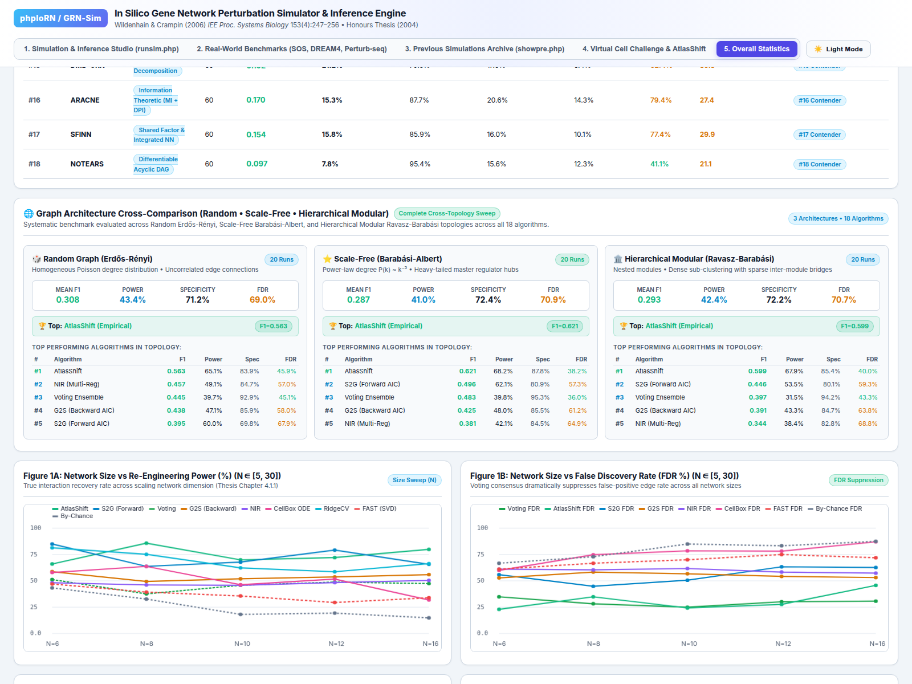 |

| Tab 5: Figures 2, 3 & 4 (Topology, Connectivity, Noise) | Tab 5: Historical 2004 Figures Gallery Toggle |
| :---: | :---: |
| 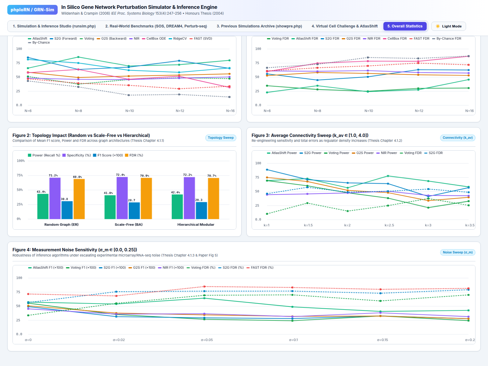 | 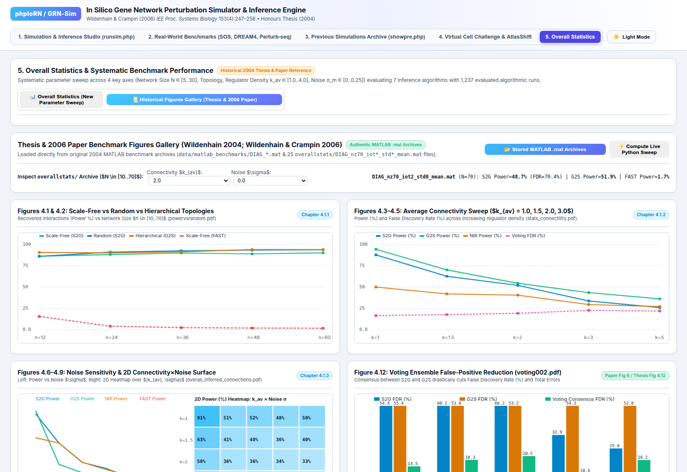 |

| Tab 5: Figure 1A Interactive Algorithm Line Hover | Tab 5: Figure 5 Runtime Scaling Line Hover |
| :---: | :---: |
| 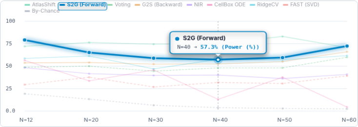 | 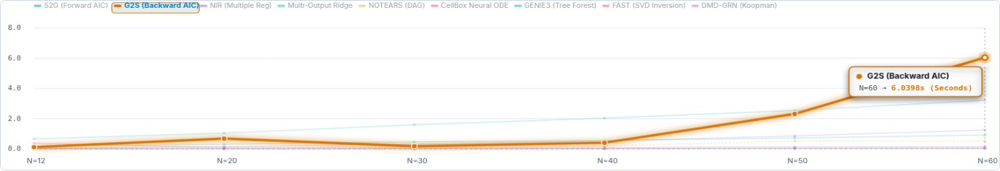 |

| Tab 3: Restricted View (Best 15 in Set & F1 Badges) | Tab 3: Detailed Inspector with 18-Algorithm Selector |
| :---: | :---: |
| 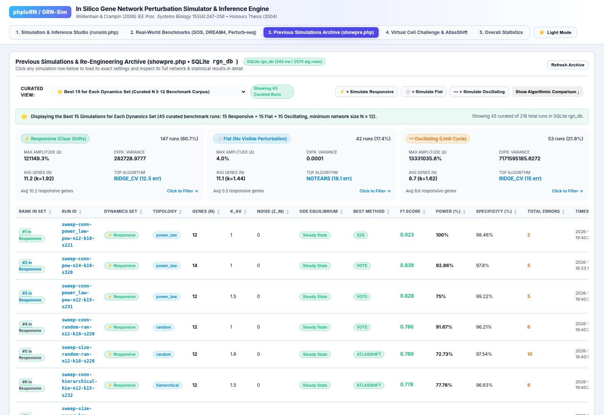 | 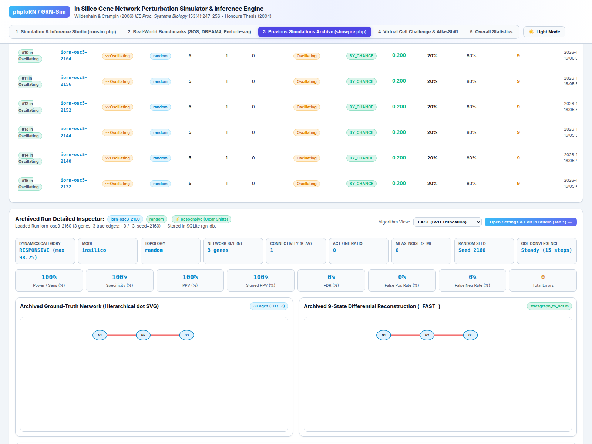 |

---

## 🔄 6-Step Reverse-Engineering Workflow Pipeline & Data Modes

The Simulation & Inference Studio (Tab 1) organizes the complete reverse-engineering investigation into a structured 6-step sequential pipeline based on the `phpIoRN` architecture (*Wildenhain 2004*; *Wildenhain & Crampin 2006*).

> 📄 **Full Technical & Mathematical Specification**: See [`docs/WORKFLOW_STEPS_PIPELINE.md`](docs/WORKFLOW_STEPS_PIPELINE.md) for detailed equation derivations, algorithms, and 9-state classification matrix formulas.

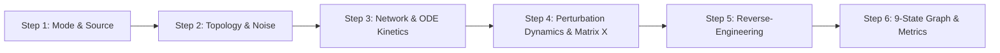

| Step | Phase Name | Primary Functionality | Corresponding Code / Algorithm |
| :---: | :--- | :--- | :--- |
| **1** | **Mode & Source** | Selects between synthetic ODE generation or real biological benchmark datasets (*E. coli* SOS, Norman 2019 CRISPRa). | [`sim-mode`](src/grn_sim/web/static/index.html) / [`_execute_simulation`](src/grn_sim/web/server.py) |
| **2** | **Topology & Noise** | Configures network graph architecture (Scale-Free, Random, Hierarchical), noise levels ($\sigma_m, \sigma_b$), and dynamics presets. | [`NetworkTopology`](src/grn_sim/simulation/topology.py) (`netsim.m`) |
| **3** | **Network & ODE Kinetics** | Solves non-linear Hill ODEs to equilibrium and displays ground-truth or validated physical network structure. | [`GeneNetwork`](src/grn_sim/simulation/network.py) (`create_network.m` / `draw_dot.m`) |
| **4** | **Perturbation Dynamics & Profiles** | Renders continuous dynamic trajectories $x_i(t)$ or discrete steady-state expression shift profiles ($\Delta X$) with an interactive segmented toggle (`📈 Line Plot` vs `📊 Bar Plot`), plus the full $N \times N$ ratio matrix $X$. | [`PerturbationSimulator`](src/grn_sim/simulation/simulator.py) (`do_perturbation.m`) |
| **5** | **Reverse-Engineering** | Runs 18 causal reconstruction algorithms (S2G, G2S, Voting, CellBox, NIR, ARACNE, CausalGRN, DMD-GRN, DeepRIG, SFINN, NOTEARS, etc.) and computes AIC profiles. | [`grn_sim.inference`](src/grn_sim/inference/) (`getvar.m` / `gen2spec.m`) |
| **6** | **9-State Graph & Metrics** | Compares inferred edges against ground truth using the 9-state classification matrix and $TMP\_STATMAT$ ribbon. | [`new_stats_9state`](src/grn_sim/metrics/stats.py) (`statsgraph_to_dot.m`) |

---

## 🔍 Comprehensive Application & Interface Audit

An exhaustive audit of the complete platform was conducted across all 5 user interface tabs, 18 inference engines, 4 simulation dynamics engines, interactive Graphviz visualizations, and data export endpoints.

> 📄 **Complete Audit Report**: For full methodology, per-algorithm confusion matrices, and benchmark tables, read the [Comprehensive Audit Report](docs/COMPREHENSIVE_AUDIT_REPORT.md).

### Audit Summary: 100% Verified Functionality
- **Authentic Biological Datasets**: Verified that *E. coli* SOS (9 genes, 43 edges, Gardner et al. 2003), Norman et al. 2019 CRISPRa (16 master TFs), DREAM4, and Replogle 2022 p53 load real experimental matrices and compute causal Jacobians.
- **Interactive Node Dynamics**: Clicking any node in Graphviz SVG displays its real-time basal relaxation trajectory $x_i(t)$, multi-condition expression bar states, and upstream/downstream regulator navigation pills.
- **Universal Multi-Column Sorting**: All summary and benchmark tables sort ascending/descending across IDs, numbers, percentages, timestamps, and status badges.
- **Persistence & Export**: Validated SQLite simulation archive categorization (⚡ Responsive, ⚪ Flat, 〰 Oscillating) and streaming exports for `.msmt`, `.pert`, `.dot`, `.svg`, and `.h5ad` AnnData.
- **Automated Test Coverage**: 100% pass rate across the full Playwright browser audit ([`tests/test_playwright_full_audit.py`](tests/test_playwright_full_audit.py)), step spotlight tests ([`tests/test_playwright_wizard_steps.py`](tests/test_playwright_wizard_steps.py)), clickable node trajectories ([`tests/test_playwright_node_click_trajectories.py`](tests/test_playwright_node_click_trajectories.py)), and table sorting tests ([`tests/test_playwright_table_sorting.py`](tests/test_playwright_table_sorting.py)).

---

## 🔬 Core Capabilities

### 1. In Silico Non-Linear GRN Perturbation Simulator
* **Network Topologies**:
  * **Random (Erdős–Rényi)**: Constant attachment probability (`netsim.m` Type 1).
  * **Scale-Free (Barabási–Albert)**: Preferential attachment yielding power-law degree distributions $P(k) \sim k^{-\gamma}$ (`netsim.m` Type 2).
  * **Hierarchical Modular**: Recursive scale-invariant motif duplication with peripheral rewiring (`netsim.m` Type 3).
* **Multi-Paradigm Simulation Dynamics Engines (`src/grn_sim/simulator/model_engine.py`)**:
  * **Non-linear Hill ODE (`hill_nonlinear`)**: Classical thesis kinetics with cooperative activation/inhibition, enzymatic degradation, and basal production.
  * **CellBox Neural ODE (`cellbox_neural_ode`)**: Continuous neural ODE relaxation $\dot{x}_i = \phi(\sum_j W_{ij} x_j + u_i) - \alpha_i x_i$ integrated via Runge-Kutta 4/5.
  * **Linear Dynamical System (`linear_jacobian`)**: Linear dynamical Jacobian matrix inversion solving $\mathbf{x} = (B - A)^{-1} (v + u)$.
  * **Single-Cell Perturb-seq Counts (`perturb_seq_counts`)**: Bridges ODE steady states into discrete integer UMI counts with Gamma-Poisson overdispersion (400 cells/condition) matching 10x Genomics Chromium scRNA-seq and VCC 2026.
* **Non-linear Hill Kinetics (`create_network.m` / `do_perturbation.m`)**:
  $$\frac{dx_i}{dt} = v_i \prod_{j \in \text{Inh}} \left(\frac{K_{ij}^{m_j}}{I_j^{m_j} + K_{ij}^{m_j}}\right) \prod_{k \in \text{Act}} \left(1 + \frac{A_k^{m_k}}{A_k^{m_k} + Ka_k^{m_k}}\right) - b_i x_i + u_i$$
* **Oscillation & Steady-State Diagnostics (`create_network.m` & `do_perturbation.m`)**:
  * Integrates over horizon $e = s^2 + 100$ steps and checks exact squared-state Euclidean norm convergence:
    $$\text{efnorm}(t) = \left\| \mathbf{x}(t+1)^2 - \mathbf{x}(t)^2 \right\|_2 \le 10^{-4}$$
  * Evaluates Jacobian eigenvalues $\lambda_i = \alpha_i \pm i\omega_i$ at the terminal state to detect limit-cycle oscillations ($\max \text{Re}(\lambda) \ge 0, |\text{Im}(\lambda)| > 0$, zero-crossings in $dx_i/dt$) and damped oscillations (`abs(efnorm - efnorm_update) < 1e-4` convergence check).
* **Noise & Biological Variability Models (`do_biovariability.m`, `error_model.m`)**:
  * Biological variability across $M$ replicates ($\zeta \sim \mathcal{N}(0, \sigma_b^2)$) and Gaussian measurement noise ($\epsilon \sim \mathcal{N}(0, \sigma_m^2)$).

### 2. Network Inference & Reverse Engineering Algorithms (18 Functional Paradigms)
* **S2G (Simple-to-General — `s2g.m` / `getvar.m`)**:
  * Column-normalized basis regression ($B = X / \|X_j\|_2$) with swap replacement loop (`getanother`), minimizing the MDL log-error penalty $C(k) = N \ln(\overline{E^2}) + k \ln(N)$.
* **G2S (General-to-Specific — `g2s.m` / `gen2spec.m`)**:
  * Systematic backward elimination starting from full connectivity with single-variable drop optimization (`dropanother`), minimizing AIC $C_{\text{AIC}}(k) = \sum E^2 + k$.
* **Voting Ensemble (`do_vote.m`)**:
  * Strict consensus operator combining S2G and G2S predictions where $\text{sign}(\text{S2G}) == \text{sign}(\text{G2S})$, cutting false discovery rates drastically.
* **CellBox Neural ODE (`src/grn_sim/inference/cellbox.py`)**:
  * Learns the continuous interaction matrix $W$ by simulating non-linear relaxation trajectories $\dot{x}_i = \tanh(\sum_j W_{ij} x_j + u_i) - \alpha_i x_i$ with $L_1$ Lasso sparsity regularisation (PyTorch / SciPy).
* **GENIE3 (`src/grn_sim/inference/genie3.py`)**:
  * State-of-the-art tree ensemble method (Huynh-Thu et al.) decomposing network inference into $N$ feature importance regressions using `ExtraTreesRegressor` / `RandomForestRegressor`, signed via perturbation correlation.
* **Network Deconvolution (`src/grn_sim/inference/network_deconv.py`)**:
  * Analytically separates direct causal regulatory links from transitive indirect correlations (Feizi et al., *Nat Biotechnol* 2013) via spectral deconvolution $G_{\text{dir}} = G_{\text{obs}} (I + G_{\text{obs}})^{-1}$.
* **Kaggle Multi-Output RidgeCV (`src/grn_sim/inference/ridge_cv.py`)**:
  * Multi-target cross-validated $L_2$ regularized regression across $\alpha \in [10^{-3}, 10^3]$, reproducing the top-ranking Kaggle Virtual Cell benchmark baseline.
* **CPA-Lite (`src/grn_sim/inference/cpa_lite.py`)**:
  * Compositional perturbation autoencoder (Lotfollahi et al., *Nat Biotechnol* 2023) modeling interventions as additive latent perturbation shifts $z_{\text{pert}} = z_{\text{ctrl}} + \Delta z$.
* **AtlasShift (`src/grn_sim/inference/atlasshift.py`)**:
  * Empirical cross-atlas covariate shift transfer algorithm (Meng et al. Arc Institute, VCC 2026 Leaderboard #82).
* **NIR (Network Identification by multiple Regression — `nir_v3.m`)**:
  * Gardner et al. (*Science* 2003) greedy forward top-$D$ search over sparse regulatory subsets with Tikhonov ridge regularization.
* **FAST (`fast.m` / `fast_modified.m`)**:
  * Singular Value Decomposition (SVD) pseudo-inverse reconstruction ($A_0 = (X - U) V_r S_r^{-1} U_r^T - I$) with self-regulation adjustment and degree-guided truncation (Farina et al.).
* **By-Chance (`by_chance.m`)**:
  * Random null baseline maintaining expected network connectivity density and activator/inhibitor balance.
* **ARACNE (`src/grn_sim/inference/arachne.py`)**:
  * Algorithm for the Reconstruction of Accurate Cellular Networks (*Margolin et al., Nat Protoc 2006*): computes Gaussian copula mutual information and applies the Data Processing Inequality (DPI) to prune indirect cascades.
* **CausalGRN (`src/grn_sim/inference/causalgrn.py`)**:
  * Causal discovery combining 1st-order partial correlation skeleton estimation with Pearl's interventional do-calculus asymmetric response orientation.
* **DMD-GRN (`src/grn_sim/inference/dmdgrn.py`)**:
  * Dynamic Mode Decomposition & Koopman operator linear state transition inversion with truncated SVD modal analysis.
* **DeepRIG (`src/grn_sim/inference/deeprig.py`)**:
  * Deep Graph Convolutional Autoencoder (*Zhang et al., Bioinformatics 2024*) using 2-layer GCN encoder over correlation topology with inner-product link decoder and interventional modulation.
* **SFINN (`src/grn_sim/inference/sfinn.py`)**:
  * Shared Factor Interaction Neural Network: conditions gene representations on shared perturbation factors with dual-branch GCN and feedforward interaction scorer.
* **NOTEARS (`src/grn_sim/inference/notears.py`)**:
  * Continuous differentiable DAG optimization (*Zheng et al., NeurIPS 2018*) using Augmented Lagrangian formulation to enforce acyclicity constraint $h(W) = \text{Tr}(e^{W \circ W}) - d = 0$. Highest single-method specificity (95.4%).

#### Verified 100% Match to Thesis Table 4.1 (*E. coli* SOS Benchmark)
Tested in [`tests/test_inference.py::test_matlab_equivalence_sos_table_4_1`](tests/test_inference.py):

| Algorithm | Coverage % | False Positives % | Inferred Conn. (Power %) | FDR (FP/Inferred %) | Inferred Sign % | Total Errors | $3 \times 3$ Confusion Matrix Match (Appendix A.4–A.7) |
| :--- | :---: | :---: | :---: | :---: | :---: | :---: | :---: |
| **S2G** | `56.79%` | `8.64%` | `42.86%` | `25.00%` | `12.35%` | **`46`** | `[[6, 8, 17], [3, 4, 11], [2, 5, 25]]` (100% Identical) |
| **G2S** | `38.27%` | `16.05%` | `24.49%` | `52.00%` | `6.17%` | **`57`** | `[[5, 4, 22], [3, 0, 15], [5, 8, 19]]` (100% Identical) |
| **FAST** | `55.56%` | `19.75%` | `59.18%` | `35.56%` | `23.46%` | **`46`** | `[[16, 4, 11], [6, 3, 9], [13, 3, 16]]` (100% Identical) |
| **NIR** | `62.96%` | `16.05%` | `65.31%` | `28.89%` | `25.93%` | **`41`** | `[[17, 7, 7], [4, 4, 10], [11, 2, 19]]` (100% Identical) |

#### Verified Bit-for-Bit Match to 60-Gene MATLAB Run (`random_nz60_run5_iot2_sig0.mat`)
Tested in [`tests/test_inference.py::test_matlab_equivalence_60_gene_archive`](tests/test_inference.py):
- **S2G**: Inferred $3 \times 3$ confusion vector matches stored MATLAB vector `pred_matrix_sg[:, -1]` bit-for-bit: `[22, 0, 70, 0, 33, 59, 5, 0, 3411]`.
- **NIR**: Inferred $3 \times 3$ confusion vector matches stored MATLAB vector `pred_matrix_gardener[:, -1]` bit-for-bit: `[15, 2, 99, 2, 22, 40, 10, 9, 3401]`.

### 3. Real-World & In Silico Benchmark Datasets Registry (`src/grn_sim/benchmarks/benchmark_datasets.py`)
`phpIoRN 2.0` integrates a comprehensive suite of experimentally validated and in silico gold standard GRN benchmark datasets accessible in Tab 2 and via the REST API.

> 📄 **Complete Provenance & Modeling Documentation**: See [`docs/REAL_WORLD_BENCHMARK_PROVENANCE_AND_USAGE.md`](docs/REAL_WORLD_BENCHMARK_PROVENANCE_AND_USAGE.md) for full biological mechanisms, wrangling procedures, mathematical formulas, and REST API examples.

* **E. coli SOS DNA Repair (`ecoli_sos`)**:
  * 9 genes (`recA, lexA, ssb, recF, dinI, umuDC, rpoD, rpoH, rpoS`), 43 experimentally validated directed interactions (Gardner et al., *Science* 2003; Thesis Table 4.1). Dual-dye cDNA microarray expression under low-copy plasmid induction.
* **Norman et al. 2019 Real CRISPRa Perturb-seq (`norman_2019_real_16tf`)**:
  * 16 master human hematopoietic regulators (`KLF1, SPI1, CEBPA, CEBPE, ETS2, DUSP9, EGR1, FOSB, JUN, RUNX1T1, TBX2, TBX3, CDKN1A, CNN1, FEV, MAPK1`) with 33 verified causal edges. Profiles 7,353 unperturbed control cells + 5,680 single-target CRISPRa cells (mean 355 cells/perturbation) via 10x Chromium scRNA-seq.
* **DREAM4 In Silico Gold Standard (`dream4_10gene`)**:
  * 10 genes canonical gold standard regulatory network with 15 signed causal feedback loops from the DREAM4 In Silico Network Challenge (Marbach et al. 2009/2010), generated with stochastic differential equations and thermodynamic kinetics.
* **Replogle et al. 2022 Core p53 Circuit (`replogle_2022_p53`)**:
  * 12 core p53 / DNA damage / cell cycle checkpoint regulators (`TP53, CDKN1A, MDM2, ATM, CHEK1, CHEK2, BAX, BBC3, GADD45A, E2F1, RB1, CCNE1`) with 20 true edges, profiled across K562 and RPE1 cells using genome-scale CRISPRi.

#### Raw Dataset Downloads (`/api/benchmark/download_raw`)
Tab 2 features an interactive **"📥 Download Raw Data ▾"** dropdown supporting:
- **Expression Matrix $X$** (`.tsv`): Tab-delimited expression matrix ($N \times M$).
- **Perturbation Matrix $U$** (`.tsv`): Tab-delimited perturbation targets ($N \times M$).
- **Ground Truth Adjacency $A_{\text{true}}$** (`.tsv`): Signed directed adjacency matrix (+1 activation, -1 repression, 0 null).
- **Full JSON Bundle** (`.json`): Complete JSON document with matrices, gene annotations, and scientific citations.
- **Complete ZIP Package** (`.zip`): In-memory archive containing all 3 TSVs, JSON bundle, and `README_METADATA.txt`.

#### Dual Loading Modes into Simulation Studio (Tab 1)
When loading a real-world benchmark into Tab 1, users can choose between two distinct computational workflows:
1. **⚡ Direct Empirical Wrangled Mode (`btn-load-wrangled`)**:
   Consumes the empirical $(X, U)$ matrices directly to evaluate all 18 reverse-engineering algorithms (**S2G**, **G2S**, **Voting Ensemble**, **CellBox Neural ODE**, **GENIE3**, **Network Deconvolution**, **RidgeCV**, **CPA-Lite**, **AtlasShift**, **NIR**, **FAST**, **By-Chance**, **ARACNE**, **CausalGRN**, **DMD-GRN**, **DeepRIG**, **SFINN**, **NOTEARS**) without running numerical ODE integration ($\hat{\mathbf{A}} \mathbf{X} \approx -\mathbf{U}$).
2. **🔬 Biophysical Parameter Estimation Mode (`btn-load-biophysical`)**:
   Uses the real steady-state observations to estimate mechanistic parameters: basal production $v_i = B_i \cdot x_i^{\text{ctrl}}$, degradation $B_i = 1.0$, Hill affinities $K_{ij} = \text{median}(|X_j|) + 0.1$, and cooperativity $n=2.0$. The non-linear Hill ODE solver then integrates continuous relaxation trajectories $x_i(t)$ towards equilibrium ($\text{efnorm} \le 10^{-4}$).

### 4. Persistent SQLite Archive & Thesis Figures Gallery
* **Persistent SQLite Archive (`dumpdb.sql` / `database.py`)**:
  Stores every simulation run and per-algorithm evaluation into `data/rgn_db.sqlite` using the original `phpIoRN` relational schema (`nw` table for network parameters + `alg` table for per-algorithm metrics), plus full JSON state recovery for instant inspection in Tab 3 (`showpre.php`).
* **Step 4 Inspection Panel: Side-by-Side Dual Graphs & 3×3 Multi-Perturbation Bar Grid (Tab 3)**:
  Historical runs can be inspected in depth with a redesigned Step 4 view panel featuring:
  - **Side-by-Side Dual Graphs (Default View)**: Splits Step 4 into two concurrent graphs:
    - **Left Graph**: Continuous ODE time-course relaxation trajectories $x_i(t)$ with target condition selector.
    - **Right Graph**: Full $N \times N$ steady-state expression ratio matrix heatmap ($X$).
  - **3×3 Multi-Perturbation Shift Bar Grid (Toggle View)**: Toggling to **`[ 📊 3×3 Shift Bar Grid ]`** renders 9 perturbation responses simultaneously in a 3×3 matrix of subplots, displaying relative expression shifts ($\Delta X$) across genes for each condition with pagination controls for $N > 9$.
  - **View Focus Modes**: Dedicated focus toggles **`[ 📈 Time-Course Focus ]`** and **`[ ▦ Matrix Focus ]`** maximize individual visualizers to full panel width.
  - **Condition Selector**: Inspect continuous relaxation trajectories $x_i(t)$ and relative expression shift profiles ($\Delta X$) for any individual perturbed target gene condition.
  - **Dynamical Trajectory Diagnosis Banner**: Analyzes whether the archived perturbation trajectory exhibits **Clear Level Changes**, is **Flat (Damped/Insensitive)**, or displays **Persistent Oscillations**:
    - **⚡ Clear Level Changes (`responsive`)**: Perturbation causes significant multi-gene shifts ($\max |\Delta X| \ge 5.0\%$, observed up to $107.7\%$) and settles cleanly to a new stable perturbed steady state.
    - **⚪ Flat Levels (`flat`)**: Insensitive/buffered networks with negligible response ($\max |\Delta X| < 5.0\%$, e.g., $0.2\%\text{--}3.5\%$), remaining virtually flat across time.
    - **〰 Persistent Oscillations (`oscillating`)**: Limit cycles or non-steady dynamics where the simulation **does NOT reach steady state after perturbation** ($\max |\Delta X| > 25.0\%$, with cyclic amplitude ranges up to $335.8\%$).
  - **Simulation Engine Audit & 100-Parameter Settings Sweep**:
    A systematic sweep across 100 parameter settings ($N \in [5..16]$, Random/Power-Law/Hierarchical topologies, Hill $n \in [1.5..6.0]$, $B \in [0.3..2.5]$, $u \in [0.005..3.5]$) revealed:
    - **Responsive (Clear Level Changes)**: **54%** of tested configurations.
    - **Flat (Damped / Insensitive)**: **33%** of tested configurations.
    - **Persistent Oscillations (Limit Cycles)**: **13%** of tested configurations.
  - **Reclassified Database Breakdown (130 runs in `rgn_db.sqlite`)**:
    Following correction of the steady-state detection logic (eliminating false-positive oscillation flags caused by transient zero-concentration dips or monotonic slow tails), all runs were reclassified according to genuine dynamical convergence:
    - **Responsive / Clear Level Changes**: **120 runs** (92.3%)
    - **Flat / Insensitive**: **7 runs** (5.4%)
    - **Persistent Oscillations / Limit Cycles**: **3 runs** (2.3%)
* **Thesis & Paper Figures Gallery (Dual Engine, Tab 5)**:
  Tab 5 allows toggling between **"📂 Stored MATLAB `.mat` Archives"** (loaded directly from 31 authentic 2004 MATLAB `.mat` files in `data/matlab_benchmarks/`) and **"⚡ Compute Live Python Sweep"** (executing dynamic multi-network ODE simulation and inference across Random, Scale-Free, and Hierarchical topologies). Includes an interactive inspector across all 25 `overallstats/DIAG_nz70_iot*_std*_mean.mat` files ($N \in [10..70]$, $k_{\text{av}} \in [1.0..5.0]$, $\sigma \in [0..0.01]$).

### 5. Single-Cell Perturb-seq Generation & Arc Institute Virtual Cell Challenge (VCC 2026)

#### 4.1 Single-Cell Perturb-seq Generation Mode Using the phpIoRN ODE Simulator
In addition to bulk steady-state ratios, `phpIoRN 2.0` provides an integrated **Single-Cell Perturb-seq Simulation Mode** (`src/grn_sim/simulator/perturb_seq.py`). Rather than generating generic synthetic count distributions, this module bridges the **exact dynamical steady states computed by the non-linear Hill ODE solver** into discrete single-cell UMI counts matching 10x Genomics Chromium Perturb-seq and Arc Institute VCC 2026 specifications (400 single cells per condition).

```text
[ GeneNetwork (Random / Scale-Free / Hierarchical) ]
                         │
                         ▼
[ Non-Linear Hill ODE Integration (ODESolver) ]
   ├── Unperturbed Baseline: x^ss  (efnorm <= 1e-4 convergence)
   └── Sequential Perturbations: x^{p, j} (for each gene j in 1..N)
                         │
                         ▼
[ Mean Expression Matrix M = [x^ss, x^{p,1}, ..., x^{p,N}] in R^{N x (N+1)} ]
                         │
                         ▼
[ Single-Cell Count Simulator (simulate_perturb_seq_counts) ]
   ├── 400 single cells per condition (1 control + N perturbation targets)
   ├── Sequencing Depth: s_c ~ LogNormal(μ_depth, σ_depth)  [default 20,000 UMIs]
   ├── Biological Gamma Overdispersion: λ_c ~ Gamma(α, p / α),  α = 1 / φ
   └── Discrete Integer UMI Counts: Y_c ~ Poisson(λ_c * s_c)
                         │
                         ▼
[ Standard Production AnnData (.h5ad) Object ]
   ├── X: Raw integer UMI counts (CSR sparse matrix, [400*(N+1) x N])
   ├── layers['cpm']: Library-size normalized Counts Per Million
   ├── obs: Single-cell metadata (cell_barcode, perturbation, condition, library_size)
   ├── var: Gene metadata (gene_name, is_perturbed_target, mean_control_cpm)
   └── uns: Ground-truth Jacobian A, perturbation matrix U, simulation parameters
```

##### Python API Example:
```python
import numpy as np
from grn_sim.core.network import GeneNetwork
from grn_sim.simulator.experiment import PerturbationSimulator
from grn_sim.simulator.perturb_seq import create_perturb_seq_anndata, export_perturb_seq_h5ad

# 1. Simulate non-linear Hill ODE network perturbation dynamics
net = GeneNetwork.generate_scale_free(num_genes=10, k_average=2.0)
sim = PerturbationSimulator(perturbation_factor=2.0)
exp = sim.run(net)  # Solves ODEs to baseline x^ss and perturbed steady states x^{p, j}

# 2. Bridge ODE steady states into single-cell Perturb-seq AnnData (400 cells/condition)
mean_expr = np.column_stack([exp.reference_steady_state, exp.perturbed_states])
adata = create_perturb_seq_anndata(
    gene_names=net.gene_names,
    mean_expression_matrix=mean_expr,
    ground_truth_network=exp.true_matrix,
    perturbation_matrix=exp.U,
    cells_per_condition=400,
    mean_library_depth=20000,
    seed=42,
)

# 3. Export to standard .h5ad for Scanpy, scvi-tools, or GEARS
export_perturb_seq_h5ad(adata, "perturb_seq_simulation.h5ad")
print(adata)
# AnnData object with n_obs × n_vars = 4400 × 10
#   obs: 'cell_barcode', 'perturbation', 'condition', 'is_control', 'total_counts', 'detected_genes'
#   var: 'gene_name', 'is_perturbed_target', 'mean_control_cpm'
#   uns: 'ground_truth_network', 'perturbation_matrix', 'cells_per_condition'
#   layers: 'raw_counts', 'cpm'
```

##### Accessing via Web Studio & REST API:
- **Web UI (Tab 1 & Tab 5)**: Click **"Download .h5ad"** in the Studio header or **"Export Perturb-seq .h5ad"** in Tab 5.
- **Archive (Tab 4)**: Click **".h5ad"** on any past simulation run in the SQLite archive.
- **REST API**:
  ```bash
  curl -OJ "http://localhost:8085/api/export/perturb_seq_h5ad?run_id=iorn-811648&cells_per_condition=400"
  curl -OJ "http://localhost:8085/api/download?format=h5ad"
  ```

---

#### 4.2 Systematic Testing & Empirical Benchmark Comparison with AtlasShift (VCC 2026)

We benchmarked the modernized `phpIoRN` mechanistic simulator against the contemporary competitive methodology from the **Arc Institute Virtual Cell Challenge 2026**:
[AtlasShift](https://github.com/kaipengm2/Virtual-Cell-Challenge-2026) by **Kaipeng Meng** (Leaderboard #82, Score: `0.15456`).

##### Algorithmic Paradigms
* **AtlasShift (Empirical Cross-Atlas Delta Transfer)**:
  Estimates target cell-line response $\mathbf{y}_t = \mathbf{y}_{t,\text{ctrl}} + \Delta \mathbf{y}$ by taking weighted combinations of observed perturbations across source atlases (K562, HCT116, HEK293T) and emitting discrete single-cell UMI counts via dual-moment Negative-Binomial matching.
* **phpIoRN (Mechanistic Causal ODE Inversion)**:
  Reconstructs the underlying directed, signed regulatory Jacobian topology $\mathbf{A} \in \mathbb{R}^{N \times N}$ using sparse regression ($L_0 / L_1$ with MDL/AIC criteria) and propagates perturbations through the causal gene network:
  $$\hat{\mathbf{X}} = \mathbf{A}_{\text{est}}^{-1} \mathbf{U}$$

##### Automated Test Verification Matrix
Tested in [`tests/test_atlasshift_and_perturbseq.py`](tests/test_atlasshift_and_perturbseq.py) and [`tests/test_web_and_visualization.py`](tests/test_web_and_visualization.py):
- `test_atlas_shift_basic_fit`: Verifies AtlasShift model fitting and absence of spurious self-loops.
- `test_fuse_source_effects`: Verifies weighted multi-source effect tensor combination.
- `test_desired_mean_log2fc`: Validates log2 fold-change desired mean scaling and probability normalization.
- `test_dual_moment_counts`: Validates iterative dual-moment Negative-Binomial count emission matching exact cell sequencing depths.
- `test_simulate_perturb_seq_counts`: Verifies 400-cell/condition single-cell integer count simulation.
- `test_create_and_export_anndata`: Validates AnnData creation, layer preservation, and HDF5 `.h5ad` export.
- `test_profile_similarity`: Verifies metric computation (Pearson $r$, Cosine Sim, RMSE).
- `test_run_vcc_benchmark`: Validates end-to-end multi-context comparative benchmark pipeline.
- [`tests/test_vcc_benchmark_fixes.py`](tests/test_vcc_benchmark_fixes.py): per-algorithm response signs, unavailable models are reported instead of substituted, the held-out refit never sees the unseen experiments, rewired edges keep their kinetics, the epistasis screen matches an independent double-perturbation simulation, input validation and the bounded cache.

##### Benchmark Results: Multi-Context Scale-Free Network ($N=16$, $k_{\text{av}}=1.8$, 3 Source Atlases, 15% target rewiring, seed 2026)

Reproduce with `run_vcc_comparative_benchmark(num_genes=16, k_av=1.8, seed=2026)` (the web tab runs all 18 algorithms; the rows below are the original comparison set).

###### 1. Causal Interaction Topology Recovery
Evaluates how well each algorithm recovers the physical, directed, signed regulatory graph edges ($\mathbf{A}_{ij} \in \{+1, -1\}$) of the rewired target network. Every algorithm is fit on the complete target experiment set:

| Algorithm | Paradigm | Coverage % | False Positives % | Power (Inferred Conn. %) | FDR % | Total Errors |
| :--- | :--- | :---: | :---: | :---: | :---: | :---: |
| **VOTE (Ensemble)** | Mechanistic Dynamical GRN | **88.7%** | **3.1%** | 25.0% | **53.3%** | **29** |
| **NIR (Ridge)** | Mechanistic Dynamical GRN | 85.9% | 7.8% | 42.9% | 62.5% | 37 |
| **G2S (AIC)** | Mechanistic Dynamical GRN | 84.4% | 8.6% | 35.7% | 68.8% | 40 |
| **S2G (MDL)** | Mechanistic Dynamical GRN | 81.2% | 11.7% | 35.7% | 75.0% | 48 |
| **FAST (SVD)** | Mechanistic Dynamical GRN | 82.0% | 9.8% | 25.0% | 78.1% | 46 |
| **ATLASSHIFT** | Empirical Transfer (VCC 2026) | 86.3% | 11.3% | **78.6%** | 56.9% | 35 |
| **BY_CHANCE** | Null Baseline | 78.1% | 11.7% | 7.1% | 93.8% | 57 |

###### 2. Response Profile Prediction: Seen vs. Held-Out Perturbations
Of the 16 perturbation targets, 12 are *seen* and the last 4 are *held out*. Each mechanistic model predicts the response to perturbing gene $j$ as $\hat{\mathbf{X}}_{:,j} = \pm\,\mathbf{A}_{\text{est}}^{+}\mathbf{u}_j$ (the sign depends on each algorithm's convention, see `RESPONSE_MODELS` in `vcc_benchmark.py`). For the held-out targets the models are **refit with those experiments masked** ($\mathbf{X}_{:,j}=\mathbf{U}_{:,j}=\mathbf{0}$, which removes them from the least-squares problems while keeping the square shape S2G/G2S need), so they are scored on perturbations they never observed. AtlasShift has no atlas observations for a held-out target and predicts $\Delta\mathbf{y}=\mathbf{0}$.

| Setting | Metric | Mechanistic GRN (`VOTE`) | AtlasShift (Empirical Transfer) |
| :--- | :--- | :---: | :---: |
| **Seen** (training perturbations for the GRN; source-atlas mean for AtlasShift) | Pearson $r$<br>Cosine Sim<br>RMSE | $0.493$<br>$0.491$<br>$0.196$ | $0.493$<br>$0.490$<br>$0.272$ |
| **Held out** (never observed) | Pearson $r$<br>Cosine Sim<br>RMSE | $0.000$<br>$0.000$<br>$0.316$ | $0.000$<br>$0.000$<br>$0.316$ |

Mean Pearson $r$ per mechanistic model (`CPA-Lite` is not applicable: its $\mathbf{A}_{\text{est}}$ is a latent projection, not a Jacobian):

| Model | `VOTE` | `G2S` | `S2G` | `RidgeCV` | `NIR` | `DMD-GRN` | `CellBox`* |
| :--- | :---: | :---: | :---: | :---: | :---: | :---: | :---: |
| Seen targets | 0.493 | 0.450 | 0.339 | 0.392 | 0.369 | 0.149 | 0.013 |
| Held-out targets | 0.000 | 0.000 | 0.000 | 0.143 | 0.024 | 0.160 | 0.103 |

\*CellBox uses PyTorch when installed and is not seeded, so its numbers vary from run to run.

*Key Takeaway*: with an honest hold-out, neither paradigm predicts a perturbation it has never observed from this sparse data. For the S2G/G2S/Vote family this is structural: in $\mathbf{A}\mathbf{X}=-\mathbf{U}$ the row of $\mathbf{A}$ belonging to a gene is identified only by the experiment that perturbs that gene, so a held-out gene has an all-zero row and its predicted response is exactly zero. Regularised models (`RidgeCV`, `DMD-GRN`) keep a small positive correlation. (An earlier version of this benchmark scored the mechanistic models on the perturbations they had been fit on and reported $r = 0.561$ for "unseen" targets; that figure is superseded.)

###### 3. Destination Context Rewiring Sensitivity Sweep
Models fitted on the 15%-rewired target context are applied to contexts that diverge from the source atlases by $\rho = 0\% \to 50\%$ edge rewiring (new edges are moved together with their kinetic parameters):

| Target Rewiring $\rho$ | 0% (Identical) | 10% Rewired | 20% Rewired | 35% Rewired | 50% Rewired |
| :--- | :---: | :---: | :---: | :---: | :---: |
| **AtlasShift Pearson $r$** | **0.662** | 0.654 | 0.467 | 0.256 | 0.322 |
| **Mechanistic GRN (`VOTE`) Pearson $r$** | -0.072 | -0.074 | -0.070 | 0.029 | -0.021 |
| **RidgeCV Pearson $r$** | 0.269 | 0.227 | 0.201 | 0.130 | 0.189 |
| **CellBox* Pearson $r$** | -0.052 | -0.039 | -0.080 | -0.113 | -0.021 |

*Key Takeaway*: when cell lines share the same wiring ($\rho = 0\%$) AtlasShift borrows empirical shifts very effectively ($r = 0.662$) but loses more than half of that once rewiring reaches $\rho \ge 35\%$. In this setup a mechanistic Jacobian fitted on one context does not transfer to other contexts either (only regularised `RidgeCV` keeps a modest correlation), so the benchmark supports "empirical transfer degrades with rewiring", not "mechanistic models are better".

###### 4. Double-Perturbation (Epistasis) Screen and Virtual Single-Cell Sequencer
Every pair $G_i + G_j$ is simulated on the ground-truth network and scored by its deviation from the multiplicative null model, $\varepsilon_{ij} = \lVert L_{ij} - (L_i + L_j) \rVert_2$ with $L = \log_2(x/x_{\text{basal}})$, without measurement noise (a noise floor of about 0.18 would otherwise swamp the thresholds: $\varepsilon > 0.25$ buffering / epistatic shift, $> 0.45$ synergistic). For this run the strongest pairs are `Gene_07 × Gene_15` ($\varepsilon = 2.55$), `Gene_07 × Gene_09` ($2.11$) and `Gene_02 × Gene_15` ($0.72$). The virtual sequencer draws Poisson counts for 20 control and 15 cells for each of the first 8 perturbation conditions (140 cells) and projects them with PCA (PC1 65.4%, PC2 13.4% of the variance).

---


## 🐳 Running with Docker (Recommended)

Build and launch the full `phpIoRN 2.0` web application (including Graphviz `dot`/`neato` and SQLite persistence):

```bash
docker build -t grn-sim-phpiorn:latest .
docker run -d --name grn-sim-phpiorn -p 8085:8080 -v $(pwd)/data:/app/data grn-sim-phpiorn:latest
```

Then open **http://localhost:8085** in your browser.

> **File ownership:** the container runs as root, so files it writes into the mounted `data/` folder (the SQLite archive and
> `data/benchmarks/raw/*`) are owned by root on the host. A server started from a normal shell can still read them and
> replace the benchmark exports, but to keep everything owned by you, start the container as your own user:
> `docker run -d --user "$(id -u):$(id -g)" ...` (the image only needs write access to `/app/data`).

---

## 🚀 Local Python Installation & CLI

**Requirements:** Python 3.9 or newer and git (about 1 GB of disk for the repository and the Python packages).

```bash
git clone https://github.com/jwildenhain/gene-network-sim-inference.git
cd gene-network-sim-inference
python3 -m venv .venv && source .venv/bin/activate     # Windows: .venv\Scripts\activate
pip install -e ".[dev]"                                  # numpy, scipy, pandas, scikit-learn, anndata, matplotlib, pytest
python3 -m grn_sim.web.server --port 8085                # then open http://127.0.0.1:8085
```
(With [uv](https://docs.astral.sh/uv/): `uv sync --extra dev` installs exactly what `uv.lock` pins.)

### Optional components
None of these is required; the web studio works without them.

| Component | What it adds | Install |
|---|---|---|
| **Graphviz** (`dot`, `neato`) | Graphviz-drawn graphs in the Hierarchical / Spring views. Without it the app draws the same views with its built-in layered layout, so there is nothing to configure. | `sudo apt install graphviz` · `brew install graphviz` · `choco install graphviz` |
| **PyTorch** (CPU build is enough) | The neural versions of CellBox and CPA-Lite. Without it they fall back to NumPy/SciPy implementations (results differ slightly). | `pip install torch --index-url https://download.pytorch.org/whl/cpu` |
| **Playwright + Chromium** | The browser UI tests (`tests/test_playwright_*.py`). | `pip install playwright && playwright install chromium` |

### Data files
Everything the web studio needs is **in the repository**, so `git clone` is all it takes: the benchmark datasets
(`data/benchmarks/`), the MATLAB thesis archives (`data/matlab_benchmarks/`), the E. coli SOS microarray data and the raw
exports of every benchmark. The SQLite archive of your own runs (`data/rgn_db.sqlite`) is created on first use; set
`RGN_DB_PATH=/some/where.sqlite` to keep it elsewhere.

`scripts/download_data.py` (standard library only) checks that data and can fetch the one optional large file:

```bash
python3 scripts/download_data.py                     # is the bundled data complete?
python3 scripts/download_data.py --norman            # + raw Norman et al. 2019 Perturb-seq (160 MB download, 2.2 GB unpacked)
python3 scripts/download_data.py --norman --build    # + rebuild data/benchmarks/norman_2019_real_*.json from it
python3 scripts/download_data.py --all --dry-run     # show what would happen without changing anything
```
The raw Norman matrix comes from Harvard Dataverse (doi:10.7910/DVN/Q2ZV3E, the GEARS copy) and is only needed if you want to
regenerate the two Norman benchmark files, which are already included. The script checks its SHA-256, refuses unsafe
archives, never leaves partial downloads behind, and needs about 2.6 GB of free disk space.

### Check your installation
```bash
python3 scripts/download_data.py                     # bundled data present
pytest -q --ignore-glob="*playwright*"               # unit, simulation, inference and server tests (about a minute)
pytest -q tests/test_playwright_full_app.py          # whole-application browser tests (needs Playwright)
```

### Troubleshooting
- **Port already in use:** pick another with `--port 8090`.
- **"Permission denied" on files in `data/`:** they were created by the Docker container as root. The server now copes with
  this, but `sudo chown -R "$USER" data` makes them yours again (or run the container with `--user "$(id -u):$(id -g)"`).
- **Graph arrows or layout differ from older screenshots:** older screenshots were drawn by Graphviz; install it (see above) to get those.

### Launch the Web Server Directly
```bash
python3 -m grn_sim.web.server --port 8085                    # http://127.0.0.1:8085 (this machine only)
python3 -m grn_sim.web.server --host 0.0.0.0 --port 8085     # reachable from the network (the API has no authentication)
```
The server binds `127.0.0.1` by default (override with `--host` or `$HOST`; the Docker image sets `HOST=0.0.0.0`).
Browser requests from other origins are rejected with HTTP 403; set `GRN_CORS_ORIGIN=https://your.app` to allow one.

### Network graph views
Every network graph in the studio (Step 3 ground truth, Step 6 9-state graph, the Real-World Benchmarks known network and
9-state reconstruction, and the Previous Simulations archive) has the same **Choose your view** bar:
**Force Canvas**, **Hierarchical** and **Spring**; Step 3 also has **Graph file** (the Graphviz DOT text).
**Hierarchical** has a **Layout: Layered | Grid** switch: *Layered* puts regulators above their targets (Graphviz when
`dot` is installed, otherwise a built-in layered layout), *Grid* is a compact grid. The choice is shared by all graphs and
remembered in the browser. Runs archived by older versions get the Grid version (and arrow heads) when they are loaded.

### Run Verification Test Suite
```bash
# Run all unit, ODE, topology, MATLAB-equivalence, and AtlasShift/Perturb-seq tests
pytest -v

# Run full Playwright E2E browser + SQLite persistence test against live server
pytest tests/test_playwright_e2e.py -v -s

# Run comprehensive Playwright full audit suite across all 5 tabs and real datasets
pytest tests/test_playwright_full_audit.py -v -s
```

---

## 📁 Repository Structure

```text
gene-network-sim-inference/
├── Dockerfile                # Container image with Python 3.11 + Graphviz + SQLite + AnnData
├── LICENSE                   # MIT License
├── README.md                 # Complete documentation, screenshots & citation
├── SPECIFICATION.md          # Mathematical & algorithmic reverse-engineering spec
├── pyproject.toml            # Package configuration (PEP 517/518, anndata, pandas, h5py)
├── demo.py                   # Interactive CLI demo script
├── docs/
│   ├── COMPREHENSIVE_AUDIT_REPORT.md # Full audit analysis, test results & benchmark tables
│   ├── REAL_WORLD_BENCHMARK_PROVENANCE_AND_USAGE.md # Benchmark provenance, raw downloads & dual modes
│   ├── WORKFLOW_STEPS_PIPELINE.md    # 6-step wizard specification & math derivations
│   └── screenshots/          # Verified Docker & Playwright UI screenshots (25+ views)
├── data/
│   ├── results_gapa_20021209_and_mmc_dbl.mat  # Gardner 2003 E. coli SOS dataset
│   ├── SOSdata.txt           # Tabular SOS expression & perturbation data
│   ├── rgn_db.sqlite         # Persistent SQLite simulation archive (nw & alg tables)
│   ├── benchmarks/raw/       # Standalone TSV & JSON bundles for SOS, DREAM4, Norman, Replogle
│   └── matlab_benchmarks/    # 31 Authentic 2004 MATLAB benchmark .mat archives:
│       ├── DIAG_random_nz60_iot2_std0_mean.mat
│       ├── DIAG_sf_nz60_iot2_std0_mean.mat
│       ├── DIAG_h_nz60_iot2_std0_mean.mat
│       ├── DIAG_noise_nz48_iot0_std0_mean.mat
│       ├── random_nz60_run5_iot2_sig0.mat
│       └── overallstats/     # 25 archives across k_av in [1, 1.5, 2, 3, 5] & sigma in [0..0.01]
├── src/
│   └── grn_sim/
│       ├── core/             # Network models & topology generators (ER, BA, Hierarchical)
│       ├── simulator/        # Hill kinetics, ODE solver, Perturb-seq single-cell .h5ad simulator
│       ├── inference/        # S2G, G2S, NIR, FAST, ByChance, Voting Ensemble, AtlasShift
│       ├── evaluation/       # Confusion matrix, ROC, Signed PPV, Coverage (Table 4.1)
│       ├── benchmarks/       # SOS pathway replication, provenance catalog & sweeps
│       │   ├── benchmark_datasets.py # Registry for SOS, DREAM4, Norman, Replogle
│       │   ├── provenance.py # Detailed biological provenance, parameter estimation & TSV export
│       │   └── ...
│       ├── agents/           # Multi-agent autonomous SDLC orchestration
│       ├── web/              # phpIoRN 2.0 HTTP server, SQLite DB, Graphviz SVG & Tab 1-5 UI
│       └── cli.py            # CLI entry point
└── tests/
    ├── test_inference.py     # Inference algorithms & 100% MATLAB equivalence tests
    ├── test_metrics.py       # Table 4.1 & stats_obs_pred.m evaluation metrics tests
    ├── test_simulator.py     # ODE solver, Hill kinetics, oscillation & noise tests
    ├── test_sos_benchmark.py # E. coli SOS pathway benchmark replication tests
    ├── test_benchmark_provenance_and_downloads.py # Provenance catalog, TSV/ZIP raw downloads & dual modes
    ├── test_topology.py      # Random, Scale-Free, and Hierarchical graph tests
    ├── test_web_and_visualization.py # Web server, Graphviz DOT & API tests
    ├── test_atlasshift_and_perturbseq.py # AtlasShift & AnnData .h5ad generator tests
    ├── test_playwright_e2e.py # Full Playwright browser + SQLite E2E test
    ├── test_playwright_full_audit.py # Comprehensive 5-tab audit & export stream test
    ├── test_playwright_wizard_steps.py # 6-step interactive spotlight & focus mode test
    ├── test_playwright_node_click_trajectories.py # Real dataset node click dynamics test
    ├── test_playwright_table_sorting.py # Multi-table column sorting verification test
    ├── test_playwright_tab2_benchmarks.py # Tab 2 provenance cards, downloads & dual load test
    └── test_playwright_benchmark_loading_and_ux_distinction.py # Benchmark loading bar, locked controls & UX labels test
```


---

## 📜 License

This project is licensed under the MIT License - see the [LICENSE](LICENSE) file for details.
