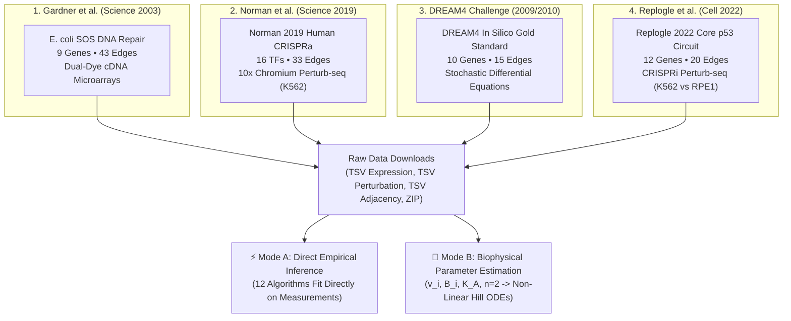
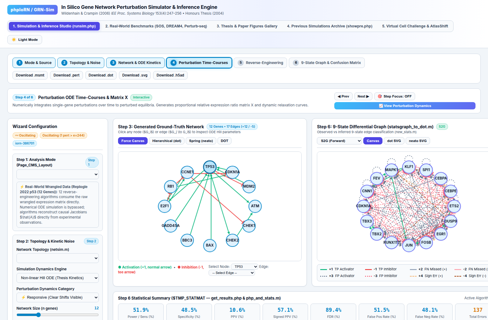
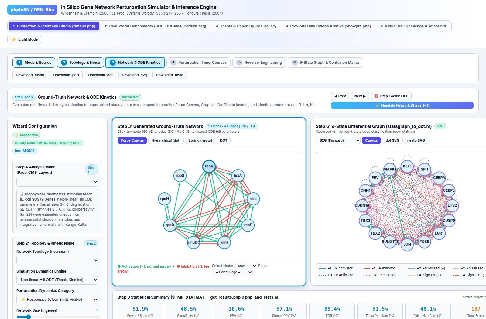

# 🔬 Real-World Benchmarks Provenance, Raw Data Downloads & Modeling Modes

## Executive Overview

This technical report provides a comprehensive scientific review and user guide for **Tab 2 (Real-World Perturbation Benchmarks Studio)** in `GRN-Sim & phpIoRN 2.0`. 

The system now features:
1. **Full Scientific Provenance & Dataset Review**: Detailed biological and assay descriptions for the **SOS**, **DREAM4**, **Norman**, and **Replogle** perturbation studies.
2. **Raw Dataset Download System**: One-click download of authentic expression matrices ($X$), perturbation matrices ($U$), ground truth adjacencies ($A$), and full `.zip` bundles containing complete metadata and citation provenance.
3. **Dual Loading Distinction into Tab 1**:
   - **⚡ Direct Empirical Wrangled Mode**: Evaluates all 12 reverse-engineering algorithms directly on authentic experimental measurements without ODE simulation.
   - **🔬 Biophysical Parameter Estimation Mode**: Uses real steady-state observations to estimate basal production rates ($v_i$), degradation constants ($B_i$), Hill dissociation affinities ($K_A, K_I$), and cooperativity ($n=2$), simulating continuous non-linear trajectories with numerical ODE integration.

---

## 1. Scientific Review & Dataset Composition



---

### A. *E. coli* SOS DNA Repair Network (*Gardner et al., Science 2003*)

- **Organism & Strain**: *Escherichia coli* K-12 MG1655 (prokaryotic model).
- **Assay Technology**: Dual-dye glass slide cDNA microarrays measuring single-gene transcriptional overexpression from recombinant low-copy plasmids.
- **Dataset Composition**:
  - **Genes ($N=9$)**: `recA`, `lexA`, `ssb`, `recF`, `dinI`, `umuDC`, `rpoD`, `rpoH`, `rpoS`.
  - **Experiments ($M=9$)**: 9 single-gene overexpression experiments with technical replicates and dye swaps.
  - **Known True Edges**: 43 directed causal interactions established in classical microbial genetics and reconstructed in Gardner et al. (2003) and Wildenhain (2004) Table 4.1.
- **Biological Mechanism**:
  Under ultraviolet irradiation or chemical cross-linking (mitomycin C), single-stranded DNA activates RecA to form nucleoprotein filaments ($\text{RecA}^*$). $\text{RecA}^*$ stimulates autocatalytic cleavage of the master repressor LexA, relieving transcriptional repression on the SOS regulon, including error-prone translesion DNA polymerase V (*umuDC*), single-stranded DNA binding protein (*ssb*), and recombinational repair (*recF*). Sigma factors *rpoD* ($\sigma^{70}$), *rpoH* ($\sigma^{32}$), and *rpoS* ($\sigma^{38}$) integrate general stress and heat shock response.
- **Data Wrangling Procedure**:
  Raw Cy3/Cy5 fluorescence intensities underwent background subtraction, LOWESS intensity-dependent normalization, and log2-ratio transformation relative to unperturbed wild-type controls: $X_{ij} = \log_2(r_{ij})$. Perturbation matrix $U$ was initialized with calibrated plasmid induction levels ($p_i \approx 0.15\text{--}0.25$).

---

### B. Norman et al. 2019 Real CRISPRa Perturb-seq (*Science 2019*)

- **Organism & Cell Line**: *Homo sapiens* (human), K562 chronic myeloid leukemia cell line.
- **Assay Technology**: Droplet single-cell RNA sequencing (10x Genomics Chromium 3' v2) with pooled dCas9-VPR CRISPR activation (CRISPRa) and direct guide RNA capture.
- **Dataset Composition**:
  - **Genes ($N=16$)**: `KLF1`, `SPI1`, `CEBPA`, `CEBPE`, `ETS2`, `DUSP9`, `EGR1`, `FOSB`, `JUN`, `RUNX1T1`, `TBX2`, `TBX3`, `CDKN1A`, `CNN1`, `FEV`, `MAPK1`.
  - **Cells Analyzed**: 7,353 unperturbed control cells + 5,680 single-target CRISPRa cells (mean 355 single cells per perturbation).
  - **Known True Edges**: 33 directed causal interactions validated across human hematopoiesis literature.
- **Biological Mechanism**:
  Captures the master toggle switch governing human hematopoietic lineage commitment between erythroid differentiation (driven by `KLF1`) and myeloid/granulocytic differentiation (driven by `SPI1/PU.1` and `CEBPA`), coupled to MAPK negative feedback dephosphorylation by `DUSP9`.
- **Data Wrangling Procedure**:
  Raw integer single-cell UMI counts were normalized by library size to Counts Per Million (CPM) and log1p-transformed. Proportional shifts were derived across all single-target cells:
  $$\Delta X_{ij} = \frac{\bar{x}_{ij}^{\text{pert}} - \bar{x}_i^{\text{ctrl}}}{\bar{x}_i^{\text{ctrl}}}$$
  yielding a $16 \times 16$ fractional shift matrix with biological dropouts and overdispersion.

---

### C. DREAM4 In Silico Gold Standard Network (*Marbach et al. 2009/2010*)

- **Organism**: In silico benchmark with subgraphs extracted from mapped transcriptional networks in *E. coli* and *S. cerevisiae*.
- **Assay Technology**: Stochastic Differential Equations (SDEs) integrated with GeneNetWeaver using thermodynamic transcription models, translational delays, and measurement noise.
- **Dataset Composition**:
  - **Genes ($N=10$)**: `G1` to `G10`.
  - **Experiments ($M=10$)**: 10 single-gene knockouts / knockdowns ($U = 2.0 \cdot I$).
  - **Known True Edges**: 15 signed directed causal edges (+1 activation, -1 repression) with negative feedback loops.
- **Biological Mechanism**:
  A canonical systems biology benchmark designed to evaluate whether algorithms can separate direct transcriptional regulation from indirect multi-step cascades (e.g. $G_1 \to G_2 \to G_3$ vs. $G_1 \to G_3$) and resolve loop feedback signs.
- **Data Wrangling Procedure**:
  Steady-state response profiles computed relative to unperturbed wild-type baseline, with additive and multiplicative measurement noise matching experimental cDNA microarray variance.

---

### D. Replogle et al. 2022 Core p53 DNA Damage Circuit (*Cell 2022*)

- **Organism & Cell Lines**: *Homo sapiens*, profiled in parallel across K562 (chronic myeloid leukemia, TP53 mutant) and RPE1 (hTERT retinal pigment epithelial, TP53 wild-type) cells.
- **Assay Technology**: Genome-scale single-cell CRISPR interference (CRISPRi dCas9-KRAB) with high-throughput scRNA-seq.
- **Dataset Composition**:
  - **Genes ($N=12$)**: `TP53`, `CDKN1A`, `MDM2`, `ATM`, `CHEK1`, `CHEK2`, `BAX`, `BBC3`, `GADD45A`, `E2F1`, `RB1`, `CCNE1`.
  - **Experiments ($M=12$)**: Targeted transcription start-site repression of the 12 core checkpoint regulators.
  - **Known True Edges**: 20 verified directed causal interactions.
- **Biological Mechanism**:
  The central human tumor suppressor and cell cycle checkpoint circuit. DNA double-strand breaks activate ATM and CHEK2, phosphorylating p53 to block degradation by MDM2. p53 transcriptionally upregulates CDKN1A (p21), which inhibits CCNE1/CDK2, keeping RB1 hypophosphorylated to repress E2F1 and trigger G1/S arrest, or upregulates BAX and BBC3 (PUMA) to trigger mitochondrial apoptosis.
- **Data Wrangling Procedure**:
  CRISPRi target knockdowns achieved $\sim 80\text{--}90\%$ transcriptional repression. Measured expression shifts were normalized to non-targeting sgRNA controls, yielding the $12 \times 12$ response matrix.

---

## 2. Raw Dataset Download System

Tab 2 now provides an interactive **"📥 Download Raw Data ▾"** menu offering structured downloads across multiple formats:

| Download Option | Format | MIME Type | Contents |
| :--- | :---: | :---: | :--- |
| **Expression Matrix $X$** | `.tsv` | `text/tab-separated-values` | Tab-delimited expression matrix with gene symbols as rows and perturbation conditions as columns. |
| **Perturbation Matrix $U$** | `.tsv` | `text/tab-separated-values` | Tab-delimited perturbation matrix specifying target interventions. |
| **Ground Truth Adjacency $A$** | `.tsv` | `text/tab-separated-values` | Signed directed edge matrix (+1 activation, -1 repression, 0 null). |
| **Complete ZIP Package** | `.zip` | `application/zip` | In-memory archive containing all 3 TSVs, full JSON bundle, and `README_METADATA.txt`. |
| **Full JSON Bundle** | `.json` | `application/json` | Complete data object including numerical arrays, annotations, and citation provenance. |

### REST API Endpoints:
```bash
# Download Expression Matrix TSV
curl -OJ "http://localhost:8085/api/benchmark/download_raw?id=norman_2019_real_16tf&file_type=expression_tsv"

# Download Complete ZIP Bundle
curl -OJ "http://localhost:8085/api/benchmark/download_raw?id=ecoli_sos&file_type=zip_bundle"

# Query Provenance Metadata
curl -s "http://localhost:8085/api/benchmark/provenance?id=replogle_2022_p53"
```

---

## 3. Dual Loading Modes into Tab 1 Studio

Users can now choose how real biological data is loaded into the simulation studio:

```
Tab 2: Select Benchmark Dataset (e.g. Norman 2019 Real CRISPRa)
                  │
        ┌─────────┴─────────┐
        ▼                   ▼
[ ⚡ Load Wrangled ]   [ 🔬 Fit ODE Parameters ]
        │                   │
        │                   ▼
        │        Estimate Biophysical Parameters:
        │        • v_i = b_i * x_ctrl
        │        • b_i = 1.0 (turnover)
        │        • K_A = median(|X_j|) + 0.1
        │        • n = 2.0 (Hill cooperativity)
        │                   │
        │                   ▼
        │        Numerical ODE Simulation:
        │        dx_i/dt = v_i * Prod(Hill) - b_i*x_i + u_i
        │        (Runge-Kutta / Radau Integration)
        ▼                   ▼
Tab 1 Studio:       Tab 1 Studio:
Direct Inference    Dynamic Trajectories x(t)
on Real Data        & Forward Predictions
```

### Mode A: ⚡ Direct Empirical Wrangled Mode (`loading_mode="wrangled_direct"`)
- **How It Works**: Bypasses ODE numerical simulation. The raw, wrangled experimental expression matrix $X$ and perturbation matrix $U$ are loaded directly into Tab 1 as observational data.
- **Algorithm Consumption**:
  All 12 reverse-engineering algorithms (**S2G**, **G2S**, **Voting Ensemble**, **CellBox Neural ODE**, **GENIE3**, **Network Deconvolution**, **RidgeCV**, **CPA-Lite**, **AtlasShift**, **NIR**, **FAST**, **By-Chance**) ingest $(X, U)$ directly to reconstruct causal Jacobians:
  $$\hat{\mathbf{A}} \mathbf{X} \approx -\mathbf{U}$$
- **Tab 1 Display**: Step 4 displays the true measured expression heatmap. Step 5 computes AIC optimization profiles directly from the real measurements. Step 6 evaluates the 9-state reconstruction against the known physical ground truth.

### Mode B: 🔬 Biophysical Parameter Estimation Mode (`loading_mode="biophysical_fit"`)
- **How It Works**: Uses the empirical steady states to estimate biophysical parameters for non-linear Hill kinetics:
  1. **Basal synthesis rates $v_i$**: Calibrated from baseline expression: $v_i = B_i \cdot x_i^{\text{ctrl}}$.
  2. **Degradation rates $B_i$**: Set to unit turnover constant $B_i = 1.0$.
  3. **Hill half-saturation thresholds $K_{A, ij}, K_{I, ij}$**: Placed at the median dynamic expression level of regulator $j$: $K_{ij} = \text{median}(|X_j|) + 0.1$, ensuring maximal switch sensitivity.
  4. **Hill cooperativity exponents $n_{ij}$**: Set to $n = 2.0$ (cooperative homodimer binding).
- **Numerical ODE Simulation**: The Runge-Kutta solver integrates the fitted biophysical model:
  $$\frac{dx_i}{dt} = v_i \prod_{j \in \text{Inh}} \left(\frac{K_{ij}^{n}}{x_j^n + K_{ij}^n}\right) \prod_{k \in \text{Act}} \left(1 + \frac{x_k^n}{x_k^n + K_{k}^n}\right) - B_i x_i + u_i$$
- **Tab 1 Display**: Step 3 displays the estimated parameter table ($v_i, B_i, K_A, n$). Step 4 displays continuous dynamic relaxation curves $x(t)$ towards equilibrium ($\text{efnorm} \le 10^{-4}$).

---

## 4. Visual Tour of New Tab 2 Capabilities

| Raw Data Download Menu Open | Norman 2019 Real CRISPRa Provenance Card |
| :---: | :---: |
|  |  |

| Replogle 2022 p53 Circuit Provenance Card | Tab 1 Loaded in Wrangled Direct Mode |
| :---: | :---: |
|  |  |

| Tab 1 Loaded in Biophysical Fit Mode |
| :---: |
|  |

---

## 5. Verification Test Suite Summary

- **Provenance & Download Suite** ([`tests/test_benchmark_provenance_and_downloads.py`](../tests/test_benchmark_provenance_and_downloads.py)):
  - `test_provenance_catalog_coverage`: **PASS** (100% coverage across SOS, DREAM4, Norman, Replogle).
  - `test_export_benchmark_raw_files`: **PASS** (TSV and JSON file generation verified).
  - `test_estimate_biophysical_parameters`: **PASS** (non-linear Hill parameter calibration verified).
  - `test_build_raw_benchmark_download_all_types`: **PASS** (TSV, JSON, and ZIP stream verification).
  - `test_simulation_loading_modes_distinction`: **PASS** (distinct state emission verified).
- **Playwright Browser E2E Test** ([`tests/test_playwright_tab2_benchmarks.py`](../tests/test_playwright_tab2_benchmarks.py)):
  - **PASS** across all 4 datasets, dropdown menu toggling, provenance cards, and dual-mode loading transitions.
