# 🔄 6-Step Reverse-Engineering Workflow Pipeline & Data Modes

This document provides a comprehensive mathematical and architectural specification of the **6-Step Reverse-Engineering Workflow Pipeline** and **Data Modes** implemented in **GRN-Sim & phpIoRN 2.0**.

This pipeline faithfully reproduces and extends the foundational systems biology workflow created by **Jan Wildenhain** and **Edmund J. Crampin** (*Wildenhain 2004 Bachelor of Honours Thesis*; *Wildenhain & Crampin 2006 IEE Proc. Systems Biology*), modernizing it for contemporary single-cell CRISPR Perturb-seq datasets and modern causal inference benchmarks.

---

## 1. High-Level Pipeline Architecture

The workflow follows a 6-step sequential process from network and perturbation specification through numerical ODE integration, causal inference, and 9-state differential topology evaluation.

```mermaid
flowchart TD
    subgraph S1["Step 1: Mode &amp; Source"]
        M1["Synthetic ODE Models"]
        M2["E. coli SOS Microarray (Gardner 2003)"]
        M3["Norman 2019 CRISPRa Perturb-seq (16 TFs)"]
    end

    subgraph S2["Step 2: Topology &amp; Kinetic Noise"]
        T1["Scale-Free / Power-Law (P(k) ~ k^-γ)"]
        T2["Erdős–Rényi Random Network"]
        T3["Hierarchical Modular Network"]
        N1["Noise Injection: σ_m (measurement), σ_b (biological)"]
        D1["Dynamics Presets: ⚡ Responsive | ⚪ Flat | 〰 Oscillating"]
    end

    subgraph S3["Step 3: Network &amp; ODE Kinetics"]
        O1["Non-linear Coupled Hill Kinetics"]
        O2["Numerical Relaxation to Basal Equilibrium x_ss"]
        O3["Interactive Graphviz (dot / neato / Canvas) &amp; Inspector"]
    end

    subgraph S4["Step 4: Perturbation Time-Courses &amp; Matrix X"]
        P1["Systematic Overexpression / Knockdown (u_j)"]
        P2["Dynamic Trajectories: x_i(t) -> x_perturbed"]
        P3["Proportional Expression Matrix: X_ij = (x_i^j - x_i^ss) / x_i^ss"]
    end

    subgraph S5["Step 5: Reverse-Engineering Algorithms"]
        A1["Forward Stepwise Regression (S2G)"]
        A2["Backward Elimination (G2S)"]
        A3["Model Complexity: AIC(K) = 2K/N + ln(RSS/σ_y^2)"]
        A4["Ensembles: Voting Consensus, CellBox Neural ODE, NIR, GENIE3"]
    end

    subgraph S6["Step 6: 9-State Differential Graph &amp; Metrics"]
        C1["9-State Topological Classification (+1, -1, +2, -2, +3, -3, +4, -4, 0)"]
        C2["$TMP_STATMAT Ribbon (Power, Specificity, PPV, Signed PPV, FDR)"]
        C3["4x4 Misclassification Matrix ($TMP_CMAT) &amp; Comparison Table"]
    end

    S1 --> S2 --> S3 --> S4 --> S5 --> S6
```



---

## 2. Summary Table of the 6 Workflow Steps

| Step | Phase Name | Primary Functionality | Mathematical & Computational Core | Interactive UI Elements | Source Code Reference |
| :---: | :--- | :--- | :--- | :--- | :--- |
| **1** | **Mode & Source** | Selects synthetic ODE generation or real experimental benchmarks (*E. coli* SOS, Norman 2019 CRISPRa). | Loads ground-truth adjacency $A \in \mathbb{R}^{N \times N}$, experimental $X$ and $U$ matrices, or initializes de novo network graph. | `#step-section-1`, `#sim-mode`, `#sim-mode-info` | [`_execute_simulation`](file:///home/jw/Documents/antigravity/peaceful-planck/gene_network_sim_inference/src/grn_sim/web/server.py#L303-L370) |
| **2** | **Topology & Noise** | Configures graph connectivity, edge signs, noise levels, and perturbation dynamics behavior. | Generates Scale-Free, Random, or Hierarchical topologies; injects log-normal measurement noise $\sigma_m$ and biological variance $\sigma_b$. | `#step-section-2`, `#sim-topology`, `#sim-num-genes`, `#sim-noise`, `#sim-dynamics-preset` | [`NetworkTopology`](file:///home/jw/Documents/antigravity/peaceful-planck/gene_network_sim_inference/src/grn_sim/simulation/topology.py) (`netsim.m`) |
| **3** | **Network & ODE Kinetics** | Solves non-linear Hill differential equations to basal steady-state equilibrium $x^{\text{ss}}$. | Evaluates non-linear Hill enzyme kinetics, checks ODE stability and convergence, extracts Jacobian $J$. | `#step-section-3`, `#gt-stage`, `#inline-param-card`, `#canvas-gt-network` | [`GeneNetwork`](file:///home/jw/Documents/antigravity/peaceful-planck/gene_network_sim_inference/src/grn_sim/simulation/network.py) (`create_network.m`) |
| **4** | **Perturbation Time-Courses** | Numerically integrates single-gene perturbation dynamics and computes normalized expression matrix $X$. | Stiff ODE integration under perturbation $u_j$; relative expression change $X_{ij} = (x_i^{\text{pert}_j} - x_i^{\text{ss}}) / x_i^{\text{ss}}$. | `#step-section-4`, `#canvas-pert-traj`, `#canvas-x-heatmap` | [`PerturbationSimulator`](file:///home/jw/Documents/antigravity/peaceful-planck/gene_network_sim_inference/src/grn_sim/simulation/simulator.py) (`do_perturbation.m`) |
| **5** | **Reverse-Engineering** | Reconstructs causal regulatory interactions using measured expression $X$ and perturbation $U$. | Stepwise AIC forward/backward selection ($S2G/G2S$), Voting consensus, CellBox Neural ODE, NIR, GENIE3, Net Deconvolution. | `#step-section-5`, `.alg-cb`, `#canvas-aic-curve`, `#btn-run-all` | [`grn_sim.inference`](file:///home/jw/Documents/antigravity/peaceful-planck/gene_network_sim_inference/src/grn_sim/inference/) (`getvar.m` / `gen2spec.m`) |
| **6** | **9-State Graph & Metrics** | Classifies inferred edges against ground truth using the 9-state classification scheme and $TMP\_STATMAT$ ribbon. | Inferred vs. Ground-truth Jacobian comparison; computes Power, Specificity, PPV, Signed PPV, FDR, Total Errors, and $4 \times 4$ confusion matrix. | `#step-section-6`, `#inf-stage`, `#statmat-subtitle`, `#tbl-alg-comparison`, `#tbl-cmat` | [`new_stats_9state`](file:///home/jw/Documents/antigravity/peaceful-planck/gene_network_sim_inference/src/grn_sim/metrics/stats.py) (`statsgraph_to_dot.m`) |

---

## 3. Detailed Step-by-Step Technical Breakdown

### Step 1: Mode & Data Source Configuration
The analysis mode determines whether the studio operates in **synthetic in silico generation mode** or loads **authentic experimental biological datasets**.

```
Analysis Modes:
├── insilico: Synthetic Non-linear Hill ODE Simulation
├── sos: E. coli 9-Gene SOS DNA Repair Network (Microarray)
└── benchmark_norman_2019_real_16tf: Human CRISPRa Perturb-seq (16 TFs, K562 cells)
```

1. **In Silico ODE Generation (`insilico`)**:
   - Synthesizes a de novo network topology according to user-selected graph models and kinetic parameters.
   - Solves coupled Hill ODEs from zero to equilibrium.
   - Allows full parametric exploration across gene counts ($N \in [6, 30]$), average connectivity ($k_{\text{av}} \in [1.0, 4.0]$), and measurement noise ($\sigma_m \in [0.0, 0.25]$).

2. **E. coli 9-Gene SOS Network (`sos`)**:
   - Replicates the real bacterial SOS DNA damage repair network from **Gardner et al., *Science* (2003)** (Thesis Table 4.1).
   - Comprises 9 genes: `recA`, `lexA`, `ssb`, `recF`, `dinI`, `umuDC`, `rpoD`, `rpoH`, `rpoS`.
   - Uses real experimental microarray steady-state expression ratios across 9 distinct perturbation experiments.
   - Automatically locks $N=9$ and fixes experimental topology.

3. **Norman et al. 2019 Real CRISPRa Perturb-seq (`benchmark_norman_2019_real_16tf`)**:
   - Sourced from authentic single-cell CRISPR activation (CRISPRa) sequencing in human K562 erythroid lineage cells (**Norman et al., *Science* 2019**).
   - Profiles 16 key transcription factors: `KLF1`, `GATA1`, `SPI1`, `CEBPA`, `RUNX1`, `TAL1`, `FLI1`, `ZFPM1`, `IKZF1`, `MYB`, `FOG1`, `NFE2`, `LMO2`, `GFI1B`, `JUN`, `FOS`.
   - Incorporates $\sim 400$ single cells per perturbation condition, normalized to proportional fractional expression changes relative to non-targeting control guides.
   - Automatically locks $N=16$ and sets the dynamics engine to single-cell count models.

---

### Step 2: Network Topology & Kinetic Noise

Step 2 configures the structural architecture of the gene regulatory network and the noise model:

#### 1. Graph Topology Models
- **Scale-Free / Power-Law ($P(k) \sim k^{-\gamma}$)**:
  - Generated via Barabási–Albert preferential attachment.
  - Produces a realistic power-law degree distribution with master regulatory hubs (e.g. key transcription factors regulating many target genes).
- **Random Network (Erdős–Rényi)**:
  - Constant edge probability $p = k_{\text{av}} / (N - 1)$ across all node pairs.
  - Poisson degree distribution without hubs.
- **Hierarchical Modular Network**:
  - Clustered submodules with dense intra-module connectivity and sparse inter-module bridge edges, modeling modular signaling pathways.

#### 2. Structural & Noise Parameters
- **Network Size ($N$)**: Number of genes in the network ($6 \le N \le 30$).
- **Average Degree ($k_{\text{av}}$)**: Average number of regulatory edges per gene ($1.0 \le k_{\text{av}} \le 4.0$).
- **Activator / Inhibitor Ratio**: Fraction of edges that act as activators ($+1$) versus repressors ($-1$).
- **Measurement Noise ($\sigma_m$)**: Microarray / sequencing technical measurement error modeled as log-normal noise:
  $$x_i^{\text{meas}} = x_i \cdot \exp(\mathcal{N}(0, \sigma_m^2))$$
- **Biological Variance ($\sigma_b$)**: Stochastic cell-to-cell variability.

#### 3. Perturbation Dynamics Presets
- **⚡ Responsive**: Standard active network where perturbations propagate through feedback loops, yielding measurable expression shifts ($|\Delta x_i| > 0.05$).
- **⚪ Flat Levels**: Highly buffered or dampened network where expression levels remain flat/quiescent, simulating homeostatic stability.
- **〰 Limit Cycle Oscillations**: High cooperativity and strong negative feedback loops that produce sustained oscillatory cycles without settling to a single static fixed point.

---

### Step 3: Network Architecture & Non-Linear ODE Kinetics

Step 3 models the non-linear transcription and degradation enzyme kinetics governing gene regulation.

#### Non-Linear Coupled Hill Differential Equation:
$$\frac{dx_i}{dt} = v_i \cdot \prod_{j \in \text{Act}(i)} \frac{x_j^{n_{A,ij}}}{K_{A,ij}^{n_{A,ij}} + x_j^{n_{A,ij}}} \cdot \prod_{k \in \text{Inh}(i)} \frac{K_{I,ik}^{n_{I,ik}}}{K_{I,ik}^{n_{I,ik}} + x_k^{n_{I,ik}}} - B_i \cdot x_i$$

Where:
- $x_i(t)$: mRNA expression level of gene $i$.
- $v_i$: Basal maximal transcription rate.
- $B_i$: First-order degradation rate constant.
- $n_{A,ij}, n_{I,ik}$: Hill cooperativity exponents (typically $n \in [1, 4]$).
- $K_{A,ij}, K_{I,ik}$: Microscopic dissociation constants.

#### Basal Relaxation & Equilibrium:
- The system starts from an initial configuration and is numerically relaxed forward using Runge-Kutta / Radau stiff ODE integrators until the derivative norm $\|\dot{x}\| < \epsilon$, establishing the basal unperturbed steady state:
  $$x^{\text{ss}} = \left[ x_1^{\text{ss}}, x_2^{\text{ss}}, \dots, x_N^{\text{ss}} \right]^T$$

#### Interactive Visualizations:
- **Force Canvas**: Interactive HTML5 physics simulation with draggable nodes and real-time spring relaxation.
- **Hierarchical (`dot`)**: Native Graphviz directed acyclic graph layout emphasizing upstream-to-downstream regulatory hierarchy.
- **Spring (`neato`)**: Force-directed Graphviz layout balancing edge lengths and node distribution.
- **ODE Parameter Inspector**: Clicking any gene node ($G_i$) or regulatory edge ($G_j \to G_i$) displays an interactive popup with exact kinetic constants ($v_i, B_i, n, K$) and the basal trajectory curve.

---

### Step 4: Systematic Perturbation Time-Courses & Matrix $X$

In Step 4, the simulator performs $N$ systematic single-gene perturbation experiments, mimicking experimental gene knockdowns or CRISPR activations:

```mermaid
sequenceDiagram
    participant Basal as Basal Equilibrium x_ss
    participant Solver as Numerical ODE Solver
    participant Exp as Experiment j (Overexpress Gene j)
    participant Matrix as Matrix X &amp; Heatmap

    Basal->>Exp: Apply perturbation factor u_j to Gene j
    Exp->>Solver: Integrate dx/dt forward in time
    Solver->>Solver: Relax through transient dynamics
    Solver->>Exp: Reach perturbed steady state x^pert_j
    Exp->>Matrix: Compute proportional change X_ij = (x_i^j - x_i^ss) / x_i^ss
```

#### Mathematical Formulation:
In experiment $j$ ($j = 1 \dots N$), the maximal transcription rate of gene $j$ is scaled by perturbation factor $u_j$:
$$\tilde{v}_j = v_j \cdot u_j$$

The stiff ODE solver integrates the network forward from $t = 0$ to $t = T_{\text{end}}$, recording the dynamic trajectories $x_i(t)$ and the final perturbed steady state $x^{\text{pert}_j}$.

#### Normalized Expression Ratio Matrix ($X$):
$$X_{ij} = \frac{x_i^{\text{pert}_j} - x_i^{\text{ss}}}{x_i^{\text{ss}}}$$

- $X_{ij} > 0$ (Green): Gene $i$ is upregulated when gene $j$ is perturbed.
- $X_{ij} < 0$ (Red): Gene $i$ is downregulated when gene $j$ is perturbed.
- $X_{ij} \approx 0$ (Black / Dark): Gene $i$ is unaffected by gene $j$.

#### Visualizations & Interactive View Controls:
- **Interactive Mode Toggle (`[ 📈 Line Plot ] [ 📊 Bar Plot ]`)**:
  - **📈 Line Plot Mode**: Renders continuous time-course relaxation trajectories $x_i(t)$ as genes dynamically transition toward perturbed steady states under target gene perturbation.
  - **📊 Bar Plot Mode**: Renders discrete relative expression shift bars ($\Delta X_{ij} = (x_i^j - x_i^{\text{ss}}) / x_i^{\text{ss}}$) across all $N$ genes for the selected target condition, color-coded by direction (Blue: perturbed target gene, Green: up-regulated, Red: down-regulated).
  - **Universal Reversibility**: Users can freely toggle between line dynamics and bar profiles at any time across both synthetic simulations and real-world benchmark datasets.
- **Matrix Heatmap ($X$)**: $N \times N$ proportional expression ratio matrix showing comprehensive pairwise responses across all perturbation conditions.

---

### Step 5: Reverse-Engineering Algorithms & Model Selection

Step 5 reverse-engineers the underlying network topology. Only the noisy measured expression matrix $X$ and the perturbation design matrix $U$ are provided to the inference algorithms; the true Jacobian and network structure remain hidden.

#### 1. S2G: Simple-to-General Forward Stepwise Regression
- Starts with an empty model (regulator subset size $K = 0$).
- Sequentially adds the candidate regulator that yields the maximum reduction in the **normalized Akaike Information Criterion (AIC)**:
  $$AIC(K) = \frac{2K}{P} + \ln\left(\frac{RSS}{\sigma_y^2}\right)$$
  Where $K$ is the number of active regulators, $P$ is the number of perturbation experiments, $RSS$ is the residual sum of squares, and $\sigma_y^2$ is the sample variance of the target gene.
- Terminates when adding further regulators increases $AIC(K)$ or exceeds the maximum degree.

#### 2. G2S: General-to-Specific Backward Elimination
- Starts with the fully-connected model containing all candidate regulators.
- Sequentially prunes edges whose removal minimizes the AIC penalty until an optimal subset is attained.

#### 3. AIC Cost Profile Curve:
The UI renders the AIC cost curve across regulator subset sizes $K = 0 \dots N$ (Thesis Figure 3.1), visually demonstrating model complexity penalization and preventing overfitting.

#### 4. Additional Supported Algorithms:
- **Voting Consensus**: Combines predictions from multiple algorithms using majority voting.
- **CellBox Continuous Neural ODE**: Recurrent neural network formulation modeling continuous ODE relaxation.
- **NIR (Multiple Linear Regression)**: Network Identification by Multiple Regression (*Gardner et al., Science 2003*).
- **GENIE3**: Random forest ensemble tree regression.
- **Network Deconvolution**: Direct vs. indirect transitive interaction matrix deconvolution.
- **RidgeCV**: Cross-validated L2 regularized regression.
- **CPA-Lite**: Compositional Perturbation Autoencoder latent embedding.
- **AtlasShift**: Vector alignment from the Virtual Cell Challenge benchmark.
- **FAST**: SVD-based linear dynamical reconstruction.
- **By-Chance**: Null benchmark predicting random edges matching degree expectation.

---

### Step 6: 9-State Differential Graph & Quantitative Evaluation

Step 6 compares the inferred Jacobian matrix $J_{\text{inf}}$ against the ground-truth Jacobian $J_{\text{true}}$ evaluated at steady state.

#### 1. 9-State Edge Classification Scheme (`statsgraph_to_dot.m`)
Each potential directed interaction $j \to i$ is classified into one of 9 mutually exclusive categories:

| State Code | Category Name | Ground Truth | Inferred | Edge Styling (Graphviz / Canvas) | Hex Color |
| :---: | :--- | :---: | :---: | :--- | :--- |
| **+1** | **True Positive Activation** | Activation ($+1$) | Activation ($+1$) | Solid line, normal arrow | `#10b981` (Emerald) |
| **-1** | **True Positive Inhibition** | Inhibition ($-1$) | Inhibition ($-1$) | Solid line, tee bar arrow | `#ef4444` (Red) |
| **+2** | **False Negative Missed Activation** | Activation ($+1$) | None ($0$) | Solid line, faint arrow | `#94a3b8` (Slate) |
| **-2** | **False Negative Missed Inhibition** | Inhibition ($-1$) | None ($0$) | Solid line, faint tee bar | `#fda4af` (Rose) |
| **+3** | **False Positive Spurious Activation** | None ($0$) | Activation ($+1$) | Dotted line, normal arrow | `#64748b` (Dark Slate) |
| **-3** | **False Positive Spurious Inhibition** | None ($0$) | Inhibition ($-1$) | Dotted line, tee bar arrow | `#FA6378` (Coral Red) |
| **+4** | **Sign Error (False Activation)** | Inhibition ($-1$) | Activation ($+1$) | Dashed line, normal arrow | `#F5C491` (Peach) |
| **-4** | **Sign Error (False Inhibition)** | Activation ($+1$) | Inhibition ($-1$) | Dashed line, tee bar arrow | `#B7673C` (Rust Brown) |
| **0** | **True Negative Non-Interaction** | None ($0$) | None ($0$) | Not drawn (empty) | *Transparent* |

#### 2. $TMP\_STATMAT$ Ribbon (8 Quantitative Performance Metrics)
Matches the statistical ribbon from `php_and_stats.m`:
- **Power / Sensitivity (%)**: $\frac{TP}{TP + FN} \times 100$
- **Specificity (%)**: $\frac{TN}{TN + FP} \times 100$
- **Precision / PPV (%)**: $\frac{TP}{TP + FP} \times 100$
- **Signed PPV (%)**: Percentage of predicted edges where the causal sign ($+$ or $-$) matches ground truth.
- **False Discovery Rate (FDR %)**: $\frac{FP}{TP + FP} \times 100$
- **False Positive Rate (FPR %)**: $\frac{FP}{TN + FP} \times 100$
- **False Negative Rate (FNR %)**: $\frac{FN}{TP + FN} \times 100$
- **Total Errors Count**: $FP + FN + \text{Sign Errors}$

#### 3. $4 \times 4$ Misclassification Matrix ($TMP\_CMAT$)
Displays the complete joint distribution between ground truth and inferred edge states:

$$\begin{pmatrix}
 & \text{Pred: Act} & \text{Pred: Inh} & \text{Pred: None} & \text{Total True} \\
\text{True: Act} & TP^+ & SignErr^{+-} & FN^+ & \sum \text{Act} \\
\text{True: Inh} & SignErr^{-+} & TP^- & FN^- & \sum \text{Inh} \\
\text{True: None} & FP^+ & FP^- & TN & \sum \text{None} \\
\text{Total Pred} & \sum \text{Pred Act} & \sum \text{Pred Inh} & \sum \text{Pred None} & N(N-1)
\end{pmatrix}$$

---

## 4. User Interface Mapping & Interactive Step Focus

When interacting with the **phpIoRN 2.0 Web Studio**, selecting or clicking any step (1 to 6) in the wizard bar triggers active UI feedback:

```
UI Mapping:
├── Step 1 ──> Sidebar Mode Selector (#step-section-1)
├── Step 2 ──> Sidebar Topology & Noise Sliders (#step-section-2)
├── Step 3 ──> Ground-Truth Network Panel (#step-section-3, #gt-stage)
├── Step 4 ──> Perturbation Dynamics & Matrix X (#step-section-4)
├── Step 5 ──> Reverse-Engineering Checkboxes & AIC Curve (#step-section-5, #panel-step5-aic)
└── Step 6 ──> 9-State Differential Graph & Metrics Ribbon (#step-section-6, #inf-stage)
```

### Interactive Behaviors on Step Selection:
1. **Contextual Guidance Banner (`#wizard-step-banner`)**: Updates to display the active step's title, operational summary, and direct action shortcut.
2. **Visual Spotlight & Animated Halo (`.step-highlight-active`)**: Applies an animated glowing border to the targeted panel and scrolls it smoothly into view.
3. **Step Focus Mode (`APP_STATE.stepFocusMode`)**: When enabled, dims non-active panels to 35% opacity, focusing the workspace exclusively on the current step's controls and visualizers.
4. **Data Mode Synchronization (`onModeChange()`)**: Switching modes in Step 1 immediately locks fixed parameters (e.g., $N=9$ for SOS, $N=16$ for Norman 2019), displays a detailed dataset summary card, and synchronizes the simulation engine.
